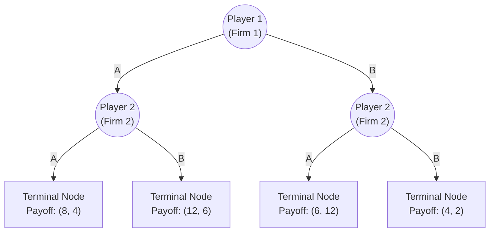

# CECS 427: Dynamic Networks — Game Theory

---

## Slide 1: Title
* **Course:** CECS 427 Dynamic Networks
* **Topic:** Games (Game Theory)

---

## Slide 2: Game Theory Foundational Assumption
* The main assumption in game theory is that the players are **intelligent (rational)**.
* *How do we define intelligent decisions?*
* To understand the meaning of intelligent or rational decisions in societies, we first consider the work *"The Basic Laws of Human Stupidity"* by economist **Carlo M. Cipolla**.

---

## Slide 3: The Basic Laws of Human Stupidity — Law 1
* **Law 1:** *"Always and inevitably, everyone underestimates the number of stupid individuals in circulation."*
  * People who were once judged rational and intelligent turn out to be unashamedly stupid.
  * Day by day, stupid individuals unexpectedly appear in the most inconvenient places.
  * Let $\sigma$ denote the fraction of stupid people within a population.

---

## Slide 4: The Basic Laws of Human Stupidity — Law 2
* **Law 2:** *"The probability that a certain person be stupid is independent of any other characteristic of that person."*
  * Whether one considers nationality, race, gender, economic status, or academic degrees (even Nobel laureates), the fraction $\sigma$ of stupid people remains constant across all groups.

---

## Slides 5–12: Cartesian Plane of Gains & Law 3
* **Law 3 (The Golden Law):** *"A stupid person is a person who causes losses to another person or to a group of persons while himself deriving no gain and even possibly incurring losses."*
* **Axes Definition:**
  * **$X$-axis:** The gain ($+$) or loss ($-$) that individual $X$ derives from their own actions.
  * **$Y$-axis:** The gain ($+$) or loss ($-$) that other individuals (or society) derive from $X$'s actions.
* **4 Basic Categories of Human Beings:**
  1. **Intelligent ($I$) — Quadrant I ($x > 0, y > 0$):** Actions benefit both themselves and others.
  2. **Helpless / Naive ($H$) — Quadrant II ($x < 0, y > 0$):** Actions enrich others at a loss to themselves.
  3. **Stupid ($S$) — Quadrant III ($x < 0, y < 0$) & negative $Y$-axis ($x = 0, y < 0$):** Actions harm others while bringing zero gain or a net loss to themselves. Moving further left ($x \ll 0, y < 0$) represents **Super Stupid**.
  4. **Bandit ($B$) — Quadrant IV ($x > 0, y < 0$):** Actions benefit themselves by causing losses to others.

### Diagram: Cipolla's Cartesian Plane of Human Behavior (Slides 5–15)
```
                            Y (Gain to Others)
                            ^
       P \                  |
          \       H_I       |            I (Intelligent)
           \ (Helpless w/   |         [x > 0, y > 0]
            \ Intelligent   |      Win-Win: Society Gains
    H_S      \  Overtone)   |
 (Helpless w/ \             |
  Stupid       \            |
  Overtone)     \           |
                 \          |
<-----------------\---------+-----------------------------> X (Gain to Self)
  <-- Super Stupid          |0 \
                            |   \         B_I (Bandit w/ Intelligent Overtone)
        S (Stupid)          |    \         [Gain x > |Loss y|: Net social gain]
      [x < 0, y < 0]        |     \
   Lose-Lose: Pure Loss     |      \  Line POM (y = -x): Perfect Bandit
                            |  B_S  \ [Gain x == |Loss y|: Zero-sum transfer]
                            | (Bandit\
                            |w/ Stupid\ M
                            | Overtone)\
                            | [Gain x < |Loss y|: Net social loss]
                            v
                        (Loss to Others)
```

* **Sub-divisions of Bandits (Slides 10–12):**
  * **Perfect Bandit (Line $OM$, where $y = -x$):** The gain derived by the bandit is exactly equal to the loss inflicted on others (pure transfer of wealth).
  * **$B_I$ (Bandits with Intelligent Overtone, above line $OM$):** Their personal gain is larger than the losses they cause to others ($x > |y|$, net positive for society).
  * **$B_S$ (Bandits with Stupid Overtone, below line $OM$):** Their personal gain is inferior to the losses they cause to others ($x < |y|$, net loss for society).
* **Sub-divisions of Helpless (Slide 15):**
  * **$H_I$ (above line $OP$):** Others gain more than $H$ loses ($y > |x|$, net social gain).
  * **$H_S$ (below line $OP$):** $H$ loses more than others gain ($|x| > y$, net social loss).

---

## Slide 13: Factors Amplifying Stupidity
* Some individuals inherit exceptional doses of the "gene of stupidity" and belong to elite groups or positions of power (bureaucrats, generals, politicians, heads of state).
* **Why Stupid People are So Dangerous:**
  * Essentially, stupid people are dangerous and damaging because reasonable people find it difficult to imagine and understand unreasonable behavior.
  * An intelligent person can understand the logic of a **bandit**, because the bandit follows a pattern of nasty rationality (maximizing $x$). You can predict a bandit's actions and build a defense.
  * **Stupid people have completely irrational behavior:**
    1. One is generally caught by surprise by their attack.
    2. Even when one becomes aware of the attack, one cannot organize a rational defense because the attack itself lacks any rational structure.

---

## Slide 14: The Basic Laws of Human Stupidity — Law 4
* **Law 4:** *"Non-stupid people always underestimate the damaging power of stupid individuals."*
  * Consistently, non-stupid people forget that at all times and places and under any circumstances, dealing and/or associating with stupid people always turns out to be a costly mistake (causing mankind incalculable losses over history).

---

## Slide 15 & 16: Law 5 & Conclusion on Social Welfare
* **Law 5:** *"A stupid person is the most dangerous type of person."*
  * **Corollary:** *"A stupid person is more dangerous than a bandit."*
* **Welfare of the Society (Conclusion):**
  * **Line $POM$ ($x + y = 0$):** Pure transfer of welfare. Society as a whole is neither better nor worse off (steady state).
  * **Right of Line $POM$ ($x + y > 0$, comprising $I, H_I, B_I$):** Actions of individuals in this region **add** to the overall welfare of society (to different degrees).
  * **Left of Line $POM$ ($x + y < 0$, comprising $S, H_S, B_S$):** Actions of individuals in this region **cause a deterioration** of societal welfare, enhancing the nefarious destructive power of stupidity.

---

## Slide 17: Introduction to Game Theory
* **Interactive Decision Making:**
  * The satisfaction of each participant with the outcome depends on:
    1. Their own decision.
    2. The decisions made by other individuals.
* **Core Components of a Game:**
  * **Players:** A set of rational participants.
  * **Strategies:** A set of options/actions available to each player.
  * **Payoffs:** For each combination of strategies, each player receives a numerical payoff (often represented in a **payoff matrix**).

---

## Slide 18: Assumptions on Reasoning About Behavior
* **Players are assumed to be:**
  1. **Selfish / Self-Interested:** Each player only cares about their own payoffs (note: "payoff" can already encode whatever the player values).
  2. **Fully Informed:** Full common knowledge of the number of players, available strategies, and the payoff matrix.
  3. **Rational:** Objective is to maximize their own expected payoff given their beliefs about what others will do.
* Game theory is designed to address situations in which the outcome of a person's decision depends not just on how they choose among several options, but also on the choices made by the people they are interacting with.

---

## Slides 19–20: Qualitative Example — The "Roommate's Dilemma"
* **Scenario:** You share an apartment with a roommate, and both of you benefit from a clean space. However, cleaning takes effort, and neither of you wants to do more than your fair share.
* **Strategies:**
  * **Clean regularly**
  * **Do nothing** (and hope the other person cleans)
* **Payoffs & Outcomes:**
  * **Both clean:** You share the workload and enjoy a tidy space (**win-win situation**).
  * **Only one person cleans:** The other enjoys the benefit without effort (**freeloading**), leading to resentment.
  * **Neither cleans:** If both think the other will clean (or want to avoid being taken advantage of), neither cleans, leading to a messy apartment making both unhappy (**lose-lose situation**).

---

## Slides 21–23: Quantitative Example — The Exam-or-Presentation Game
* **Scenario:** Two pieces of coursework are due the next day: an **Exam** and a **Presentation**.
* **Assumptions:**
  1. You can either **study for the exam** OR **prepare for the presentation**, but not both (time constraint).
  2. You have an accurate estimate of the expected grade you will get under the outcomes of different decisions.
  3. **No communication:** Neither partner is allowed to contact or make binding agreements with the other.
* **Grading Structure:**
  * **Presentation Grade (Joint Grade):**
    * If **both** prepare: Joint grade $= 100$.
    * If **only one** prepares: Joint grade $= 92$.
    * If **neither** prepares: Joint grade $= 84$.
  * **Exam Grade (Personal Grade):**
    * If you **study**: Personal exam grade $= 92$.
    * If you **do not study**: Personal exam grade $= 80$.
  * **Final Course Payoff:** Average of the two grades:
    $$\text{Payoff} = \frac{\text{Presentation Grade} + \text{Exam Grade}}{2}$$

* **Calculating the 4 Possible Outcomes (Slide 23):**
  1. **Both prepare for Presentation:**
     * Both get $100$ on presentation and $80$ on exam $\implies \frac{100 + 80}{2} = \mathbf{90}$ each.
  2. **Both study for Exam:**
     * Both get $84$ on presentation and $92$ on exam $\implies \frac{84 + 92}{2} = \mathbf{88}$ each.
  3. **One studies for Exam, the other prepares for Presentation:**
     * *The one who prepares for Presentation:* Gets $92$ (presentation) and $80$ (exam) $\implies \frac{92 + 80}{2} = \mathbf{86}$.
     * *The one who studies for Exam:* Still gets $92$ on the joint presentation, plus $92$ on the exam $\implies \frac{92 + 92}{2} = \mathbf{92}$.

---

## Slide 24: Tabular Presentation (Payoff Matrix)
* To summarize payoffs (outcomes), a $2 \times 2$ normal-form payoff table is used.
* In each cell `(u, v)`, the first number `u` is **Your payoff** (Row Player), and the second number `v` is **Your Partner's payoff** (Column Player).

| You \ Your Partner | Presentation | Exam |
| :--- | :---: | :---: |
| **Presentation** | $90, 90$ | $86, 92$ |
| **Exam** | $92, 86$ | $88, 88$ |

---

## Slides 25–28: One-Shot Games & Prediction of the Outcome
* **One-Shot Games:** Games in which players simultaneously and independently choose their actions, and do so only once.
* **Best-Response Analysis (Slide 26):**
  * *Case 1: Suppose your partner studies for the Exam.*
    * If you prepare for Presentation: you get $86$.
    * If you study for Exam: you get $88$.
    * **Best choice:** Study for the Exam ($88 > 86$).
  * *Case 2: Suppose your partner prepares for the Presentation.*
    * If you prepare for Presentation: you get $90$.
    * If you study for Exam: you get $92$.
    * **Best choice:** Study for the Exam ($92 > 90$).
* **Conclusion & Paradox (Slides 27–28):**
  * **No matter what your partner does, you should study for the Exam.** Assuming both players are rational, both will choose `Exam`, resulting in payoffs of $(88, 88)$.
  * **Striking Conclusion:** Even though both players know they would be better off if both prepared for the presentation $(90, 90)$, that outcome **cannot be achieved by rational play** without a binding contract, because each player has a personal incentive to defect to `Exam` to get $92$.

---

## Slide 29: Summary of Assumptions on Rational Behavior
1. **Everything a player cares about is summarized in their payoffs.** (Note: Nothing in game theory requires players to care *only* about selfish material rewards; altruism or fairness can be built into the payoff numbers, though standard models start with personal rewards.)
2. **Each player knows everything about the structure of the game** (who the players are, available strategies, and the payoff matrix).
3. **Rationality:** Every player chooses a strategy to maximize their own payoff given their beliefs about the strategies used by the other players.

---

## Slides 30–31: The Prisoner's Dilemma
* **Scenario:** Two suspects (Suspect 1 and Suspect 2) are interrogated separately. Each must choose between two strategies: **Confess ($C$)** or **Not Confess ($NC$)**.
* **Preference Ordering:** $P(C, NC) > P(NC, NC) > P(C, C) > P(NC, C)$.
* **Payoffs (measured in negative years in prison):**

| Suspect 1 \ Suspect 2 | Not Confess ($NC$) | Confess ($C$) |
| :--- | :---: | :---: |
| **Not Confess ($NC$)** | $-1, -1$ | $-10, 0$ |
| **Confess ($C$)** | $0, -10$ | $-4, -4$ |

* **Reasoning for Suspect 1:**
  * If Suspect 2 plays $C$: Suspect 1 gets $-4$ by playing $C$, and $-10$ by playing $NC$. Since $-4 > -10$, Suspect 1 should play **$C$**.
  * If Suspect 2 plays $NC$: Suspect 1 gets $0$ by playing $C$, and $-1$ by playing $NC$. Since $0 > -1$, Suspect 1 should play **$C$**.
* **Result:** Confessing ($C$) is a **strictly dominant strategy** for both suspects. Both confess and serve 4 years each $(-4, -4)$, even though mutual cooperation $(NC, NC)$ would have resulted in only 1 year each $(-1, -1)$.

---

## Slide 32: Do We Always Have a Prisoner's Dilemma?
* Suppose we modify the Exam-or-Presentation game by making the **Exam much easier**, so that you get $100$ if you study, and $96$ if you don't:
  * Both Presentation: Presentation $= 100$, Exam $= 96 \implies \text{Avg} = 98$.
  * You Presentation, Partner Exam: Presentation $= 92$. You get $\frac{92+96}{2} = 94$; Partner gets $\frac{92+100}{2} = 96$.
  * Both Exam: Presentation $= 84$, Exam $= 100 \implies \text{Avg} = 92$.

| You \ Your Partner | Presentation | Exam |
| :--- | :---: | :---: |
| **Presentation** | $98, 98$ | $94, 96$ |
| **Exam** | $96, 94$ | $92, 92$ |

* **New Analysis:**
  * If Partner plays `Presentation`: $98 > 96 \implies$ Play `Presentation`.
  * If Partner plays `Exam`: $94 > 92 \implies$ Play `Presentation`.
* Now, `Presentation` is a **strictly dominant strategy**, and rational play achieves the socially optimal outcome $(98, 98)$. The Prisoner's Dilemma only manifests when the incentive structure meets specific conditions.

---

## Slides 33–34: Formal Definitions — Best Responses and Dominant Strategies
* Let $P_1(S, T)$ and $P_2(S, T)$ denote the payoffs to Player 1 and Player 2 when Player 1 chooses strategy $S$ and Player 2 chooses strategy $T$.
* **Best Response:**
  * Strategy $S$ for Player 1 is a **best response** to strategy $T$ for Player 2 if:
    $$P_1(S, T) \ge P_1(S', T) \quad \text{for all other strategies } S' \text{ of Player 1}$$
* **Strict Best Response:**
  * Strategy $S$ for Player 1 is a **strict best response** to strategy $T$ for Player 2 if:
    $$P_1(S, T) > P_1(S', T) \quad \text{for all other strategies } S' \neq S \text{ of Player 1}$$
* **Dominant Strategy:**
  * A **dominant strategy** for Player 1 is a strategy that is a best response to *every* strategy of Player 2.
  * A **strictly dominant strategy** for Player 1 is a strategy that is a strict best response to *every* strategy of Player 2.

---

## Slide 35: Test Your Knowledge — Price War Game
* **Scenario:** When prices are stable, both firms make $\$40$. If one firm cuts prices (starts a Price War) while the other keeps Stable Prices, the price-cutter sees profits rise to $\$60$, while the other firm loses market share and gets $\$0$. If both engage in a Price War, both make only $\$3$.

| Firm A \ Firm B | Stable Price | Price War |
| :--- | :---: | :---: |
| **Stable Price** | $\$40, \$40$ | $\$0, \$60$ |
| **Price War** | $\$60, \$0$ | $\$3, \$3$ |

* **Solution:**
  * **Best Responses for Firm A:**
    * If Firm B plays `Stable Price`: Firm A's strict best response is `Price War` ($\$60 > \$40$).
    * If Firm B plays `Price War`: Firm A's strict best response is `Price War` ($\$3 > \$0$).
  * **Dominant Strategy:** `Price War` is a strictly dominant strategy for both Firm A and Firm B.
  * **Recommendation for Firm A:** In a one-shot non-cooperative game, Firm A must choose `Price War` (to avoid getting $\$0$, and to get $\$60$ if B is naive), resulting in the $(\$3, \$3)$ Prisoner's Dilemma outcome.

---

## Slides 36–39: Games Where Only One Player Has a Dominant Strategy (Marketing Strategy)
* **Scenario:** Two firms (Firm 1 and Firm 2) each choose whether to produce a **Low-Priced** product or an **Upscale** product.
* **Market Structure:**
  * $60\%$ of the population prefers **Low-Priced** ($0.60$ of total market).
  * $40\%$ of the population prefers **Upscale** ($0.40$ of total market).
  * **Brand Strength:** Firm 1 is the more popular brand. When both firms directly compete in the same segment, Firm 1 gets $80\%$ of sales and Firm 2 gets $20\%$.
  * If a firm is the sole producer in a segment, it gets $100\%$ of sales in that segment.
* **Payoff Calculations:**
  * Both Low-Priced: Firm 1 gets $0.80 \times 0.60 = 0.48$; Firm 2 gets $0.20 \times 0.60 = 0.12$.
  * Both Upscale: Firm 1 gets $0.80 \times 0.40 = 0.32$; Firm 2 gets $0.20 \times 0.40 = 0.08$.
  * Different segments: Low-Priced firm gets $0.60$; Upscale firm gets $0.40$.

| Firm 1 \ Firm 2 | Low-Priced | Upscale |
| :--- | :---: | :---: |
| **Low-Priced** | $0.48, 0.12$ | $0.60, 0.40$ |
| **Upscale** | $0.40, 0.60$ | $0.32, 0.08$ |

* **Strategic Analysis (Slide 39):**
  * **Firm 1 has a strictly dominant strategy:** `Low-Priced` is a strict best response when Firm 2 plays `Low-Priced` ($0.48 > 0.40$) and when Firm 2 plays `Upscale` ($0.60 > 0.32$).
  * **Firm 2 does NOT have a dominant strategy:**
    * If Firm 1 plays `Upscale`, Firm 2's best response is `Low-Priced` ($0.60 > 0.08$).
    * If Firm 1 plays `Low-Priced`, Firm 2's best response is `Upscale` ($0.40 > 0.12$).
  * **Predicted Outcome:** Since Firm 2 knows Firm 1 is rational and will play its strictly dominant strategy `Low-Priced`, Firm 2 will respond with `Upscale`. The outcome is **(Low-Priced, Upscale)** with payoffs $(0.60, 0.40)$.

---

## Slides 40–42: Games With No Dominant Strategies (Two Firms, Three Clients)
* **Scenario:** Two firms (Firm 1 and Firm 2) simultaneously choose which of three clients (**A, B, or C**) to approach.
  * **Client Values:** Client A is a large client worth $8$. Clients B and C are smaller clients worth $2$ each.
  * **Rules:**
    * Client A will only do business if **both** firms approach A (splitting the business: $4$ to each firm). If only one approaches A, A gives $0$ business.
    * Firm 1 is larger/specialized such that if both firms approach the same smaller client (B or C), they split it ($1$ each). However, Firm 1 is unable to attract business on its own if it approaches a client alone ($0$ payoff).
    * Firm 2 can win the full business ($2$) of Client B or C if it approaches B or C alone.

| Firm 1 \ Firm 2 | Client A | Client B | Client C |
| :--- | :---: | :---: | :---: |
| **Client A** | $4, 4$ | $0, 2$ | $0, 2$ |
| **Client B** | $0, 0$ | $1, 1$ | $0, 2$ |
| **Client C** | $0, 0$ | $0, 2$ | $1, 1$ |

* **Best Response Analysis (Slide 42):**
  * **Neither firm has a dominant strategy.**
  * **Firm 1's strict best responses:**
    * To Firm 2's `A` $\implies$ `A` ($4 > 0$).
    * To Firm 2's `B` $\implies$ `B` ($1 > 0$).
    * To Firm 2's `C` $\implies$ `C` ($1 > 0$).
  * **Firm 2's strict best responses:**
    * To Firm 1's `A` $\implies$ `A` ($4 > 2$).
    * To Firm 1's `B` $\implies$ `C` ($2 > 1$).
    * To Firm 1's `C` $\implies$ `B` ($2 > 1$).
  * **Mutual Best Responses:** Only **(A, A)** is a pair of mutual best responses!

---

## Slide 43: Nash Equilibrium
* In 1950, **John Nash** proposed a simple but powerful principle for reasoning about behavior in general games:
  * *Even when there are no dominant strategies, we should expect players to use strategies that are mutual best responses to each other.*
* **Definition (Nash Equilibrium):**
  * Suppose Player 1 chooses strategy $S$ and Player 2 chooses strategy $T$. The pair $(S, T)$ is a **Nash equilibrium** if:
    1. $S$ is a best response to $T$, AND
    2. $T$ is a best response to $S$.
* **Interpretation:**
  * This concept cannot be derived purely from individual rationality alone; it is an **equilibrium concept**.
  * If players choose strategies that are best responses to each other, then **no player has a unilateral incentive to deviate** to an alternative strategy—so the system is in an equilibrium state.

---

## Slides 44–47: Multiple Equilibria — Coordination Games
* Some natural games have **more than one Nash equilibrium**, making it difficult to predict which equilibrium rational players will coordinate on.
* **Real-World Examples (Slide 45):**
  * Two manufacturing companies deciding whether to configure machinery in **Metric** or **English (Imperial)** units.
  * Two army platoons deciding whether to attack an enemy's **left flank** or **right flank**.
  * Two people trying to meet in a crowded mall deciding whether to wait at the **North end** or **South end**.
* **Slide Preparation Coordination Game (Slide 46):**
  * You and a partner must prepare slides for a joint presentation without being able to contact each other, choosing either **PowerPoint** or **Keynote**.

| You \ Your Partner | PowerPoint | Keynote |
| :--- | :---: | :---: |
| **PowerPoint** | $1, 1$ | $0, 0$ |
| **Keynote** | $0, 0$ | $1, 1$ |

* **Analysis:** Both **(PowerPoint, PowerPoint)** and **(Keynote, Keynote)** are pure-strategy Nash equilibria. If players mis-coordinate, they get $(0, 0)$.

---

## Slide 48: Variants — Unbalanced Coordination Game
* Suppose both you and your partner agree that **Keynote** is twice as good as **PowerPoint**:

| You \ Your Partner | PowerPoint | Keynote |
| :--- | :---: | :---: |
| **PowerPoint** | $1, 1$ | $0, 0$ |
| **Keynote** | $0, 0$ | $2, 2$ |

* Both **(PowerPoint, PowerPoint)** and **(Keynote, Keynote)** are still Nash equilibria! However, **(Keynote, Keynote)** gives strictly higher payoffs to both players (it is *payoff-dominant* / Pareto-superior), creating a natural focal point.

---

## Slide 49: Risk Dominance (Harsanyi–Selten Criterion)
* Consider a general symmetric $2 \times 2$ coordination game:

| Player 1 \ Player 2 | $L$ | $R$ |
| :--- | :---: | :---: |
| **$L$** | $(a, a)$ | $(b, c)$ |
| **$R$** | $(c, b)$ | $(d, d)$ |

* where $a > c$ and $d > b$, so both $(L, L)$ and $(R, R)$ are Nash equilibria.
* Let $p^*$ be the probability that Player 2 plays $L$ which makes Player 1 **indifferent** between playing $L$ and $R$:
  $$p^* a + (1 - p^*) b = p^* c + (1 - p^*) d$$
  $$p^* = \frac{d - c}{(a - b) - (c - d)} = \frac{d - c}{a - b - c + d}$$
* **Risk Dominance Decision Rule:**
  * If $p^* < \frac{1}{2}$, then **$(L, L)$ is risk-dominant** (playing $L$ is optimal even if you assign less than $50\%$ probability to the partner playing $L$).
  * If $p^* > \frac{1}{2}$, then **$(R, R)$ is risk-dominant**.

---

## Slide 50: Variants — Battle of the Sexes
* Things get more complicated when you and your partner **disagree** on which software you prefer (You prefer Keynote; Your Partner prefers PowerPoint), though both still prefer coordinating over mis-coordinating:

| You \ Your Partner | PowerPoint | Keynote |
| :--- | :---: | :---: |
| **PowerPoint** | $1, 2$ | $0, 0$ |
| **Keynote** | $0, 0$ | $2, 1$ |

* **Equilibria:** **(PowerPoint, PowerPoint)** with payoffs $(1, 2)$ and **(Keynote, Keynote)** with payoffs $(2, 1)$. Social conventions or outside focal points are often needed to break the symmetry.

---

## Slides 51–53: Variants — Stag Hunt
* **Scenario:** Two hunters are out hunting.
  * If they **work together** (`Hunt Stag`), they catch a stag worth $4$ each.
  * On their own, each can **catch a hare** (`Hunt Hare`) worth $3$.
  * If one hunts stag alone while the other hunts hare, the stag hunter gets $0$, while the hare hunter still gets $3$.

| Hunter 1 \ Hunter 2 | Hunt Stag | Hunt Hare |
| :--- | :---: | :---: |
| **Hunt Stag** | $4, 4$ | $0, 3$ |
| **Hunt Hare** | $3, 0$ | $3, 3$ |

* **Analysis (Slide 52):**
  * Both **(Hunt Stag, Hunt Stag)** and **(Hunt Hare, Hunt Hare)** are Nash equilibria.
  * Unlike simple Unbalanced Coordination, if the two players mis-coordinate, the one who tried for the higher-payoff outcome (`Hunt Stag`) gets **penalized heavily ($0$)**, whereas `Hunt Hare` guarantees a safe payoff of $3$ regardless.
  * *(Note: Using Slide 49's formula with $a=4, b=0, c=3, d=3$: $p^* = \frac{3-3}{4-0-3+3} = 0$ if hare gives $3$ always, or in the Exam-Presentation Stag Hunt below where $a=90, b=82, c=88, d=88$, $p^* = \frac{88-88}{90-82-88+88} = \frac{3}{4}$ if $(Exam, Exam)$ is $(88,88)$ and $(Exam, Pres)$ is $(88,82)$).*

* **Exam-or-Presentation: Stag-Hunt Version (Slide 53):**
  * Suppose the presentation requires *both* partners to prepare to get $100$; otherwise, if at most one prepares, the presentation gets the base grade of $84$.
  * Payoffs:
    * Both Presentation: $\frac{100+80}{2} = 90$ each.
    * One Presentation, One Exam: Presentation $= 84$. Presentation person gets $\frac{84+80}{2} = 82$; Exam person gets $\frac{84+92}{2} = 88$.
    * Both Exam: Presentation $= 84$, Exam $= 92 \implies \frac{84+92}{2} = 88$ each.

| You \ Your Partner | Presentation | Exam |
| :--- | :---: | :---: |
| **Presentation** | $90, 90$ | $82, 88$ |
| **Exam** | $88, 82$ | $88, 88$ |

---

## Slides 54–56: Games with No Pure Nash Equilibrium & Matching Pennies
* **Attack-Defense / Zero-Sum Games:**
  * In some games, no pair of pure strategies is a mutual best response.
  * **Attacker vs. Defender:** Attacker chooses target $A$ or $B$; Defender defends $A$ or $B$. Defender wins if they match; Attacker wins if they mismatch.
* **Matching Pennies (Slide 56):**
  * Two players simultaneously show **Heads ($H$)** or **Tails ($T$)**.
  * **Player 1** wins ($+1$) if they **mismatch**, and loses ($-1$) if they **match**.
  * **Player 2** wins ($+1$) if they **match**, and loses ($-1$) if they **mismatch**.

| Player 1 \ Player 2 | Heads ($H$) | Tails ($T$) |
| :--- | :---: | :---: |
| **Heads ($H$)** | $-1, +1$ | $+1, -1$ |
| **Tails ($T$)** | $+1, -1$ | $-1, +1$ |

* **Zero-Sum Game:** In every cell, the payoffs of the two players sum to zero.

---

## Slides 57–61: Mixed Strategies and Indifference Analysis
* **Enlarging the Strategy Space (Slide 57):**
  * Players do not choose $H$ or $T$ deterministically; instead, they choose a **probability distribution** over their pure strategies:
    * **Player 1's strategy:** Probability $p \in [0, 1]$ of playing $H$ (and $1 - p$ of playing $T$).
    * **Player 2's strategy:** Probability $q \in [0, 1]$ of playing $H$ (and $1 - q$ of playing $T$).
* **Expected Payoffs for Player 1 Given $q$ (Slide 59):**
  * If Player 1 plays pure strategy $H$:
    $$\mathbb{E}[\text{Payoff}_1(H, q)] = (-1)(q) + (+1)(1 - q) = 1 - 2q$$
  * If Player 1 plays pure strategy $T$:
    $$\mathbb{E}[\text{Payoff}_1(T, q)] = (+1)(q) + (-1)(1 - q) = 2q - 1$$
* **Equilibrium Condition (Slides 60–61):**
  * Why can't any pure strategy ($p=0$ or $p=1$) be part of a Nash equilibrium? If $p = 1$ ($H$), Player 2's best response is $q = 1$ ($H$), to which Player 1's best response is $p = 0$ ($T$).
  * Thus, at a mixed-strategy Nash equilibrium, both $p$ and $q$ must lie strictly in $(0, 1)$.
  * **Indifference Principle:** If $1 - 2q \neq 2q - 1$, Player 1 would put $100\%$ probability on whichever pure strategy gives the strictly higher expected payoff. For Player 1 to be willing to randomize ($0 < p < 1$), Player 2 must choose $q$ to make Player 1 **indifferent** between $H$ and $T$:
    $$1 - 2q = 2q - 1 \implies 4q = 2 \implies q^* = \frac{1}{2}$$
  * By symmetric reasoning, Player 1 must choose $p^* = \frac{1}{2}$ to make Player 2 indifferent.

---

## Slide 62: General $2 \times 2$ Mixed-Strategy Nash Equilibrium Formulas
* Consider a general $2 \times 2$ game:

| Player A \ Player B | Strategy C ($q$) | Strategy D ($1 - q$) |
| :--- | :---: | :---: |
| **Strategy A ($p$)** | $a, e$ | $b, f$ |
| **Strategy B ($1 - p$)** | $c, g$ | $d, h$ |

* **Expected Payoffs:**
  * **Player A:**
    $$U_A(p, q) = pq a + p(1 - q)b + (1 - p)qc + (1 - p)(1 - q)d$$
  * **Player B:**
    $$U_B(p, q) = pq e + p(1 - q)f + (1 - p)qg + (1 - p)(1 - q)h$$
* **Nash Equilibrium Indifference Conditions:**
  1. **Player A mixes ($p$) so Player B is indifferent between Strategy C and Strategy D:**
     $$\mathbb{E}[U_B(\text{Strategy C})] = \mathbb{E}[U_B(\text{Strategy D})] \iff p e + (1 - p)g = p f + (1 - p)h$$
  2. **Player B mixes ($q$) so Player A is indifferent between Strategy A and Strategy B:**
     $$\mathbb{E}[U_A(\text{Strategy A})] = \mathbb{E}[U_A(\text{Strategy B})] \iff q a + (1 - q)b = q c + (1 - q)d$$

---

## Slide 63: Test Your Knowledge — Computing Optimal Mixed Strategies
* **Game Matrix:**

| Player 1 \ Player 2 | Strategy 1 ($q$) | Strategy 2 ($1 - q$) |
| :--- | :---: | :---: |
| **Strategy 1 ($p$)** | $4, 3$ | $1, 1$ |
| **Strategy 2 ($1 - p$)** | $0, 0$ | $3, 4$ |

* **Step-by-Step Solution:**
  * *Note on Pure Equilibria:* `(Strategy 1, Strategy 1)` with $(4,3)$ and `(Strategy 2, Strategy 2)` with $(3,4)$ are pure Nash equilibria. To find the **mixed-strategy Nash equilibrium**:
  1. **Find $q$ (Player 2's mix) to make Player 1 indifferent:**
     * Expected payoff to Player 1 from Strategy 1: $4q + 1(1 - q) = 3q + 1$
     * Expected payoff to Player 1 from Strategy 2: $0(q) + 3(1 - q) = 3 - 3q$
     * Set equal:
       $$3q + 1 = 3 - 3q \implies 6q = 2 \implies q^* = \frac{1}{3}$$
     * Player 2 plays Strategy 1 with probability $\frac{1}{3}$ and Strategy 2 with probability $\frac{2}{3}$.
  2. **Find $p$ (Player 1's mix) to make Player 2 indifferent:**
     * Expected payoff to Player 2 from Strategy 1: $3p + 0(1 - p) = 3p$
     * Expected payoff to Player 2 from Strategy 2: $1p + 4(1 - p) = 4 - 3p$
     * Set equal:
       $$3p = 4 - 3p \implies 6p = 4 \implies p^* = \frac{2}{3}$$
     * Player 1 plays Strategy 1 with probability $\frac{2}{3}$ and Strategy 2 with probability $\frac{1}{3}$.

---

## Slides 64–66: Pareto Optimality and Social Optimality
* In a Nash equilibrium, players act individually to maximize their own payoff, which does not guarantee a socially desirable outcome (e.g., Prisoner's Dilemma / Exam-or-Presentation Game).
* **Definition — Pareto Optimality (Slide 65):**
  * A choice of strategies (outcome) is **Pareto-optimal** if there is **no other outcome** in which all players receive payoffs at least as high, and at least one player receives a strictly higher payoff.
  * If an outcome is *not* Pareto-optimal, there is an alternative outcome that makes at least one player strictly better off without harming anyone else.
* **Definition — Social Optimality (Slide 66):**
  * A choice of strategies is a **social welfare maximizer (socially optimal)** if it maximizes the **sum (or average) of all players' payoffs**:
    $$\max_{(S_1, \dots, S_n)} \sum_{i=1}^n P_i(S_1, \dots, S_n)$$
* **Theorem 1:** *Every socially optimal outcome is Pareto-optimal.*
  * *Proof:* Suppose an outcome were socially optimal but *not* Pareto-optimal. Then there would exist another outcome where every player's payoff is $\ge$ their current payoff and at least one player's payoff is $>$. The sum of payoffs in that alternative outcome would be strictly larger, contradicting social optimality!
  * *(Note: The converse is NOT always true—an outcome can be Pareto-optimal without maximizing the total sum of payoffs, e.g., $(92, 86)$ in the Exam-or-Presentation game is Pareto-optimal with sum $178$, whereas $(90, 90)$ is both socially optimal with sum $180$ and Pareto-optimal).*

---

## Slides 67–70: Multi-Player Games and Strictly Dominated Strategies
* **Multi-Player Game Notation (Slide 68):**
  * $n$ players: $\{1, 2, \dots, n\}$.
  * Joint strategy (outcome): $(S_1, S_2, \dots, S_n)$.
  * Payoff function for player $i$: $P_i(S_1, \dots, S_n)$.
* **Best Response in $n$-Player Games (Slide 69):**
  * $S_i$ is a best response by player $i$ to $(S_1, \dots, S_{i-1}, S_{i+1}, \dots, S_n)$ if:
    $$P_i(S_1, \dots, S_{i-1}, S_i, S_{i+1}, \dots, S_n) \ge P_i(S_1, \dots, S_{i-1}, S'_i, S_{i+1}, \dots, S_n) \quad \forall S'_i$$
* **Strictly Dominated Strategy (Slide 70):**
  * A strategy $S_i$ is **strictly dominated** if player $i$ has another strategy $S'_i$ that produces a strictly higher payoff in response to **every possible choice of strategies** by the other players:
    $$P_i(S_1, \dots, S_{i-1}, S'_i, S_{i+1}, \dots, S_n) > P_i(S_1, \dots, S_{i-1}, S_i, S_{i+1}, \dots, S_n) \quad \forall S_{-i}$$
  * *Key Fact:* A rational player will **never** play a strictly dominated strategy.

---

## Slides 71–75: Facility Location Game & Iterative Deletion of Strictly Dominated Strategies
* **Scenario (Slide 71):** Two firms plan to simultaneously open a store in one of six towns located along six consecutive highway exits: **A, B, C, D, E, F**.

```
Highway Exits (Equal customer population of 1 per town):
  (A) ------- (B) ------- (C) ------- (D) ------- (E) ------- (F)
Firm 1      Firm 2      Firm 1      Firm 2      Firm 1      Firm 2
Option      Option      Option      Option      Option      Option
```

* **Rules:**
  * **Firm 1** can locate at **A, C, or E**.
  * **Firm 2** can locate at **B, D, or F**.
  * Customers in each town go to whichever store is closer to them along the highway.
  * Example: If Firm 1 is at **C** and Firm 2 is at **B**, Firm 2 captures `{A, B}` (payoff $2$) and Firm 1 captures `{C, D, E, F}` (payoff $4$).

* **Full $3 \times 3$ Payoff Matrix (Slide 72):**

| Firm 1 \ Firm 2 | Town B | Town D | Town F |
| :--- | :---: | :---: | :---: |
| **Town A** | $1, 5$ | $2, 4$ | $3, 3$ |
| **Town C** | $4, 2$ | $3, 3$ | $4, 2$ |
| **Town E** | $3, 3$ | $2, 4$ | $5, 1$ |

* **Step-by-Step Iterative Deletion (Slides 72–75):**
  * *Initial Check:* Neither player has a strictly dominant strategy right away.
  * **Step 1 (Eliminate A and F):**
    * For Firm 1, compare **Town A** $(1, 2, 3)$ vs. **Town C** $(4, 3, 4)$: Since $4 > 1$, $3 > 2$, and $4 > 3$, **Town A is strictly dominated by Town C**. Eliminate Row A!
    * For Firm 2, compare **Town F** $(3, 2, 1)$ vs. **Town D** $(4, 3, 4)$: Since $4 > 3$, $3 > 2$, and $4 > 1$, **Town F is strictly dominated by Town D**. Eliminate Column F!
  * **Step 2 (Reduced $2 \times 2$ Game — Slide 73):**

| Firm 1 \ Firm 2 | Town B | Town D |
| :--- | :---: | :---: |
| **Town C** | $4, 2$ | $3, 3$ |
| **Town E** | $3, 3$ | $2, 4$ |

  * Now in this reduced game:
    * For Firm 1, **Town E** $(3, 2)$ is strictly dominated by **Town C** $(4, 3)$. Eliminate Row E!
    * For Firm 2, **Town B** $(2, 3)$ is strictly dominated by **Town D** $(3, 4)$. Eliminate Column B!
  * **Step 3 (Final $1 \times 1$ Reduced Game — Slide 74):**
    * Only **(Town C, Town D)** remains, with payoffs **$(3, 3)$**!
* **Theorem / Fact (Slide 75):** The set of Nash equilibria of the original game coincides with the set of Nash equilibria of the final reduced game obtained via **Iterative Deletion of Strictly Dominated Strategies (IDSDS)**.

---

## Slide 76: Weakly Dominated Strategies
* **Definition:** A strategy is **weakly dominated** if there is another strategy that does *at least as well* no matter what the other players do, and *strictly better* against at least one joint strategy of the other players.
* **Crucial Distinction:**
  * Strictly dominated strategies can **never** be part of a Nash equilibrium and can always be safely deleted without losing Nash equilibria.
  * **Weakly dominated strategies CAN be part of a Nash equilibrium!** Deleting them can eliminate valid Nash equilibria.
* **Example (Modified Stag Hunt):**

| Hunter 1 \ Hunter 2 | Hunt Stag | Hunt Hare |
| :--- | :---: | :---: |
| **Hunt Stag** | $3, 3$ | $0, 3$ |
| **Hunt Hare** | $3, 0$ | $3, 3$ |

  * Here, `Hunt Stag` is weakly dominated by `Hunt Hare` (since `Hunt Hare` always gives $3$, whereas `Hunt Stag` gives $3$ or $0$).
  * Yet **(Hunt Stag, Hunt Stag)** is still a valid Nash equilibrium!

---

## Slides 77–80: Dynamic Games & Extensive-Form Game Trees
* **Dynamic (Sequential) Games:**
  * Instead of players choosing strategies simultaneously, play occurs sequentially over time: one player moves first, other players observe the choice made, and then respond.
* **Market Entry / Regional Advertising Example (Slide 78):**
  * Two firms (Firm 1 and Firm 2) decide whether to focus marketing on **Region A** (total profit $= 12$) or **Region B** (total profit $= 6$).
  * **Sequential Move Order:**
    1. **Firm 1 (Player 1)** chooses first (`A` or `B`).
    2. **Firm 2 (Player 2)** observes Firm 1's choice and then chooses (`A` or `B`).
  * **Payoff Rules:**
    * If both firms enter the **same region**, Firm 1's "first-mover advantage" gives it $\frac{2}{3}$ of that region's market profit, while Firm 2 gets $\frac{1}{3}$:
      * Both in A: Firm 1 gets $\frac{2}{3}(12) = 8$, Firm 2 gets $\frac{1}{3}(12) = 4$.
      * Both in B: Firm 1 gets $\frac{2}{3}(6) = 4$, Firm 2 gets $\frac{1}{3}(6) = 2$.
    * If they enter **different regions**, each gets $100\%$ of its region's profit:
      * Firm 1 in A, Firm 2 in B: $(12, 6)$.
      * Firm 1 in B, Firm 2 in A: $(6, 12)$.

### Extensive-Form Game Tree Diagram (Slides 79–80)


* **Backward Induction Analysis:**
  * If Player 1 chooses **A** (left branch): Player 2 compares `A` (payoff $4$) vs. `B` (payoff $6$) and chooses **B**. Outcome: $(12, 6)$.
  * If Player 1 chooses **B** (right branch): Player 2 compares `A` (payoff $12$) vs. `B` (payoff $2$) and chooses **A**. Outcome: $(6, 12)$.
  * Anticipating Player 2's rational response, Player 1 compares getting $12$ (by choosing **A**) vs. getting $6$ (by choosing **B**).
  * Therefore, Player 1 chooses **A**, Player 2 responds with **B**, and the subgame-perfect equilibrium outcome is **$(12, 6)$**.