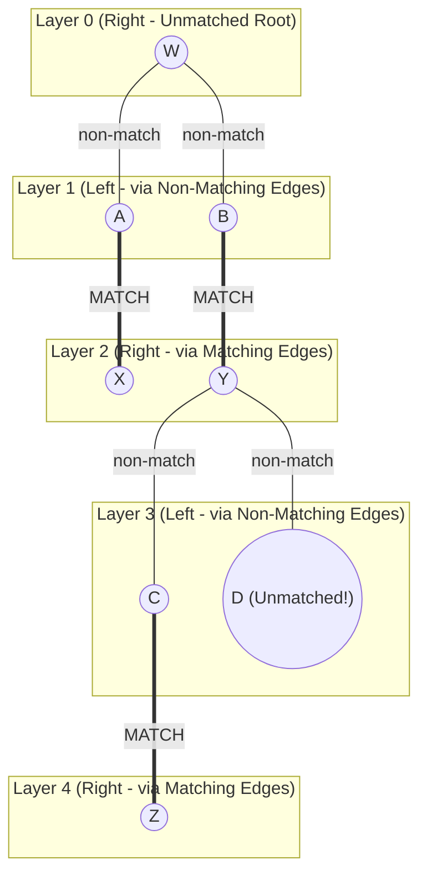

# CECS 427: Dynamic Networks — Markets, Power Grids, and Bipartite Matching

---

## Slide 1: Title
* **Course:** CECS 427 Dynamic Networks
* **Topic:** Markets (Power Grid Markets & Matching Markets)

---

## Slide 2: Power Grids and Smart Grids
* **Power Grid:** An electricity network that uses advanced technologies to monitor and manage the flow of electricity from generation sources to consumers.
* **Smart Grids:** Improve the delivery of electricity by using two-way communication and intelligent devices.
* **Core Question:** *How do we obtain and allocate the energy needed for cities dynamically across time?*

---

## Slides 3–8: Energy Generation Sources — Pros, Cons, and Adaptability

| Energy Source | Mechanism | Pros | Cons | Adaptability |
| :--- | :--- | :--- | :--- | :--- |
| **Nuclear Power Plants** (Slide 3) | Thermal power station where heat source is a nuclear reactor | Clean energy (zero carbon emissions), Reliable (24/7 base load), Cost-effective per MW | Radioactive waste, Environmental impact, **Takes days to ramp up/down** | **Very Low** (Not adaptable to short-term spikes) |
| **Solar Farms** (Slide 4) | Generate electricity using solar photovoltaic panels | Renewable energy, Very low marginal cost | **Intermittent** energy source (daylight/weather dependent), Land/environmental impact | **Intermittent** (Cannot be dispatched on command) |
| **Wind Farms** (Slide 5) | Generate electricity using wind turbines | Renewable energy, Very low marginal cost | **Intermittent** energy source (wind dependent), Environmental/visual impact | **Intermittent** |
| **Hydropower** (Slide 6) | Generate electricity using kinetic energy of moving water | Renewable energy, Low cost, **Adaptable** (can open/close turbines quickly) | Water diversion, Ecosystem/environmental impact | **High** (Fast response) |
| **Coal / Fossil Fuel Stations** (Slide 7) | Thermal power station burning coal/gas to generate steam | Reliable, **Highly adaptable** (can ramp up/down on demand) | High pollution / greenhouse gases, **Expensive** marginal fuel cost | **High** (Dispatchable) |
| **Geothermal Energy** (Slide 8) | Drill deep wells near volcanic/tectonic heat to generate steam | Inexpensive, Renewable, Environmentally friendly, **Adaptable** | Geographically restricted locations, Local environmental concerns | **High** |

---

## Slide 9: Daily Power Demand Curve (Summer vs. Winter)
* **Graph Description:**
  * **X-Axis:** Hour of the day ($1$ to $24$).
  * **Y-Axis:** Hourly Average Demand ($\%$ of Seasonal Peak, from $50\%$ to $100\%$).
  * **Summer Curve (Red):**
    * Drops to a minimum of $\sim 52\%$ around hours $4\text{–}5$ AM.
    * Rises steadily through the morning and afternoon due to air conditioning load.
    * Reaches a single broad peak of **$100\%$ around hours $15\text{–}17$ (3:00 PM – 5:00 PM)**, then declines in the evening.
  * **Winter Curve (Blue):**
    * **Bimodal (Two Peaks):**
      * Minimum of $\sim 70\%$ around hours $2\text{–}3$ AM.
      * **Morning Peak:** Rises sharply to **$100\%$ at hour $8$ (8:00 AM)** as heating and morning activity start.
      * Dips during midday (down to $\sim 75\%$ at hour $16$ / 4:00 PM).
      * **Evening Peak:** Rises again to **$\sim 94\%$ around hours $19\text{–}20$ (7:00 PM – 8:00 PM)** when people return home and turn on heating/lights.

---

## Slides 10–11: Comparing Cost per Megawatt and Environmental Damage

### Slide 10: Cost per Megawatt (Marginal Generation Cost)
```
Cost / MWatt
  ^
  |                                                       (O)
  |                                                        |
  |                                                        |
  |                         (O)                           |
  |     (O)       (O)        |        (O)       (O)        |
  +------+---------+---------+---------+---------+---------+-----> Source
       Solar     Wind      Hydro    Thermal   Nuclear     Coal
      (Low)     (Low)    (Low-Med)   (Low)   (Lowest)   (Highest)
```

### Slide 11: Environmental Damage
```
Environmental Damage
  ^
  |                                                       (O)
  |                                             (O)        |
  |                         (O)                  |         |
  |                                   (O)        |         |
  |     (O)       (O)        |         |         |         |
  +------+---------+---------+---------+---------+---------+-----> Source
       Solar     Wind      Hydro    Thermal   Nuclear     Coal
     (Lowest)   (Low)     (Medium) (Low-Med)  (High)   (Highest)
```

---

## Slide 12: Auctions in the Power Grid
* **Time Horizons:**
  * **Long-Term Auctions (Days, Weeks):** Used to secure steady **base load** power.
  * **Short-Term Spot Auctions (Minutes, Hours):** Used to handle real-time fluctuations in current consumption.
* **Truthful Bidding Mechanism:**
  * All participants submit electronic bids equal to their **true marginal cost (value)** per Megawatt.
* **How Different Plants Participate:**
  1. **Nuclear Plants:** True cost per MW is very low, but since they are *not adaptable*, they submit bids **only to long-term auctions**.
  2. **Solar & Wind Farms:** True cost per MW is very low, but since they are *intermittent/weather-dependent*, they submit bids **only to short-term auctions** (when generation is available).
  3. **Geothermal & Hydropower Plants:** True cost per MW is low (though slightly higher than solar, wind, and nuclear). Because they are adaptable, they submit bids **only to short-term auctions**.
  4. **Coal & Fossil Fuel Plants:** True cost per MW is the **highest**. Because they are reliable and adaptable, they submit bids to **both short-term and long-term auctions** (serving as marginal "peaker" plants when cheaper sources are exhausted).

---

## Slides 13–15: Bipartite Graphs and the Dorm Room Assignment Problem
* **Bipartite Graph (Slide 13):**
  * A graph whose nodes are divided into two disjoint categories/sets **$A$** (left) and **$B$** (right), such that every edge connects a node in $A$ to a node in $B$ (no edges exist within $A$ or within $B$).
* **Dorm Rooms Example (Slides 14–15):**
  * $5$ students (`Aleks`, `Richard`, `Thomas`, `Karen`, `Sophia`) and $5$ rooms (`Room 1` to `Room 5`).
  * Each student has preferences (acceptable options) for certain rooms, represented by edges.
  * **Goal:** Assign rooms to maximize the happiness of the students (give every student an acceptable room).

---

## Slides 16–18: Perfect Matchings and Constricted Sets
* **Definition — Perfect Matching (Slide 16):**
  * A subset of edges in a bipartite graph (with $|A| = |B| = n$) such that **every node is incident to exactly one selected edge** (a $1\text{-to-}1$ bijection between $A$ and $B$).
* *Question:* How do we know if a bipartite graph does **not** have a perfect matching?

### Example of a Graph Without a Perfect Matching (Slides 17–18)
* **Acceptable Room Edges:**
  * `Aleks` $\to$ `{Room 1}`
  * `Richard` $\to$ `{Room 1}`
  * `Thomas` $\to$ `{Room 2}`
  * `Karen` $\to$ `{Room 3, Room 4, Room 5}`
  * `Sophia` $\to$ `{Room 2, Room 5}`

```
Students (Set A)                     Rooms (Set B)
+-------------------+                +-------------------+
|  ( Aleks ) -------+----------------+--> ( Room 1 )     |
|                   |                +-------------------+
|  ( Richard ) -----+                |  N(S) = {Room 1}
+-------------------+
  S = {Aleks, Richard}

   ( Thomas ) --------------------------> ( Room 2 ) <---+
                                                         |
   ( Karen ) ---------------------------> ( Room 3 )     |
        | \-----------------------------> ( Room 4 )     |
        \-------------------------------> ( Room 5 ) <---+
                                                         |
   ( Sophia ) -------------------------------------------+
```

* **Observation (Slide 18):**
  * Consider the subset of students $S = \{\text{Aleks}, \text{Richard}\}$.
  * Their combined set of acceptable neighbors is $N(S) = \{\text{Room 1}\}$.
  * Since $|S| = 2 > |N(S)| = 1$, both Aleks and Richard only want `Room 1`, so it is **impossible** to match both of them!

---

## Slide 19: Test Your Knowledge — Perfect Matching or Constricted Set?
* **Graph Edges on Slide 19:**
  * `Aleks` $\to$ `{Room 1}`
  * `Richard` $\to$ `{Room 1}`
  * `Thomas` $\to$ `{Room 2}`
  * `Karen` $\to$ `{Room 3, Room 4, Room 5}`
  * `Sophia` $\to$ `{Room 1}`
* **Solution:**
  * **Does a perfect matching exist?** **No.**
  * **Constricted Sets ($|S| > |N(S)|$):**
    1. $S_1 = \{\text{Aleks}, \text{Richard}\} \implies N(S_1) = \{\text{Room 1}\}$ ($2 > 1$).
    2. $S_2 = \{\text{Aleks}, \text{Sophia}\} \implies N(S_2) = \{\text{Room 1}\}$ ($2 > 1$).
    3. $S_3 = \{\text{Richard}, \text{Sophia}\} \implies N(S_3) = \{\text{Room 1}\}$ ($2 > 1$).
    4. $S_4 = \{\text{Aleks}, \text{Richard}, \text{Sophia}\} \implies N(S_4) = \{\text{Room 1}\}$ ($3 > 1$).
    5. Any union of the above with `Thomas` (e.g., $S_5 = \{\text{Aleks}, \text{Richard}, \text{Sophia}, \text{Thomas}\}$ has $N(S_5) = \{\text{Room 1}, \text{Room 2}\}$, where $4 > 2$).

---

## Slide 20: Hall's Marriage Theorem (Constricted Set Theorem)
* **Definition — Constricted Set:**
  * Let $S \subseteq A$ be a subset of nodes on the left, and let $N(S) \subseteq B$ be the set of all neighbors of nodes in $S$.
  * We say that $S$ is **constricted** if:
    $$|S| > |N(S)|$$
* **Theorem 1:** *If there exists a constricted set $S$, there can be NO perfect matching.*
  * *Proof:* In a perfect matching, each of the $|S|$ nodes in $S$ would have to be matched to a distinct node in $N(S)$, which is impossible by the Pigeonhole Principle since $|N(S)| < |S|$.
* **Theorem 2 (Hall's Marriage Theorem, 1935):** *If a bipartite graph (with $|A| = |B|$) has no perfect matching, then it MUST contain at least one constricted set.*

---

## Slides 21–23: Valuations, Preferences, and Maximum Weight Matching
* Suppose students have **numerical valuations** (how much they like each room):

| Student \ Preference | Room 1 | Room 2 | Room 3 |
| :--- | :---: | :---: | :---: |
| **Aleks** | $12$ | $2$ | $4$ |
| **Richard** | $8$ | $7$ | $6$ |
| **Thomas** | $7$ | $5$ | $2$ |

* **Quality of an Assignment:** The sum of valuations of the matched pairs.
  * **Assignment 1 (Slide 22):**
    * `Aleks` $\to$ `Room 1` ($12$)
    * `Richard` $\to$ `Room 2` ($7$)
    * `Thomas` $\to$ `Room 3` ($2$)
    * **Total Quality:** $12 + 7 + 2 = \mathbf{21}$.
  * **Assignment 2 — Optimal / Maximum Weight Matching (Slide 23):**
    * `Aleks` $\to$ `Room 1` ($12$)
    * `Richard` $\to$ `Room 3` ($6$)
    * `Thomas` $\to$ `Room 2` ($5$)
    * **Total Quality:** $12 + 6 + 5 = \mathbf{23}$ (**Maximum Matching**).

---

## Slides 24–27: Decentralized Markets — Prices, Payoffs, and Preferred Sellers
* **Moving from Central Coordination to Decentralized Prices (Slide 24):**
  * Instead of a central administrator forcing an assignment, can we use **market prices** so buyers self-select into an optimal matching?
* **Market Setup:**
  * $n$ **Sellers** (each holding 1 house for sale) and $n$ **Buyers** (each wanting 1 house).
  * **Buyer Valuations:** Buyer $j$ has valuation $v_{ij} \ge 0$ for the house held by seller $i$.
  * **Seller Valuations (Slide 25):** Without loss of generality, sellers have a baseline valuation of $0$ for keeping their house; they care only about the payment $p_i$ they receive.
* **Prices and Buyer Payoffs (Slide 26):**
  * Seller $i$ sets a price $p_i \ge 0$ for their house.
  * If Buyer $j$ buys from Seller $i$ at price $p_i$, Buyer $j$'s payoff (surplus) is:
    $$\text{Payoff}_{ij} = v_{ij} - p_i$$
  * Each Buyer $j$ wants to maximize their payoff:
    1. Ties between equally good sellers are broken arbitrarily.
    2. If $v_{ij} - p_i < 0$ for all sellers $i$, Buyer $j$ refuses to buy (payoff $0$).
* **Preferred Seller(s) (Slide 27):**
  * For a given price vector $p = (p_1, \dots, p_n)$, Seller $i$ is a **preferred seller** of Buyer $j$ if buying from $i$ maximizes $v_{ij} - p_i$ (and $v_{ij} - p_i \ge 0$).

---

## Slides 28–30: Examples of Preferred-Seller Graphs
* **Setup:** 3 Sellers ($a, b, c$) and 3 Buyers ($x, y, z$).
* **Valuation Matrix ($v_{ij}$ for sellers $a, b, c$):**
  * Buyer $x$: $(12, 4, 2)$
  * Buyer $y$: $(8, 7, 6)$
  * Buyer $z$: $(7, 5, 2)$

### Case 1 (Slide 28): Prices $p_a = 5, p_b = 1, p_c = 0$
| Buyer | Valuations $(a, b, c)$ | Payoffs $(v_{ja}-5,\; v_{jb}-1,\; v_{jc}-0)$ | Max Payoff | Preferred Seller(s) |
| :--- | :---: | :---: | :---: | :--- |
| **Buyer $x$** | $12, 4, 2$ | $12-5=\mathbf{7},\; 4-1=3,\; 2-0=2$ | $7$ | $\{a\}$ |
| **Buyer $y$** | $8, 7, 6$ | $8-5=3,\; 7-1=\mathbf{6},\; 6-0=\mathbf{6}$ | $6$ | $\{b, c\}$ |
| **Buyer $z$** | $7, 5, 2$ | $7-5=2,\; 5-1=\mathbf{4},\; 2-0=2$ | $4$ | $\{b\}$ |

* **Resulting Matching:** $x \to a$, $z \to b$, and $y \to c$. Every buyer gets a distinct preferred house! **(Market-Clearing Prices)**

### Case 2 (Slide 29): Prices $p_a = 5, p_b = 2, p_c = 0$
| Buyer | Valuations $(a, b, c)$ | Payoffs $(v_{ja}-5,\; v_{jb}-2,\; v_{jc}-0)$ | Max Payoff | Preferred Seller(s) |
| :--- | :---: | :---: | :---: | :--- |
| **Buyer $x$** | $12, 4, 2$ | $12-5=\mathbf{7},\; 4-2=2,\; 2-0=2$ | $7$ | $\{a\}$ |
| **Buyer $y$** | $8, 7, 6$ | $8-5=3,\; 7-2=5,\; 6-0=\mathbf{6}$ | $6$ | $\{c\}$ |
| **Buyer $z$** | $7, 5, 2$ | $7-5=2,\; 5-2=\mathbf{3},\; 2-0=2$ | $3$ | $\{b\}$ |

* **Resulting Matching:** Unique preferred edges: $x \to a$, $y \to c$, $z \to b$. **(Market-Clearing Prices)**

### Case 3 — Test Your Knowledge (Slide 30): Prices $p_a = 2, p_b = 1, p_c = 0$
| Buyer | Valuations $(a, b, c)$ | Payoffs $(v_{ja}-2,\; v_{jb}-1,\; v_{jc}-0)$ | Max Payoff | Preferred Seller(s) |
| :--- | :---: | :---: | :---: | :--- |
| **Buyer $x$** | $12, 4, 2$ | $12-2=\mathbf{10},\; 4-1=3,\; 2-0=2$ | $10$ | $\{a\}$ |
| **Buyer $y$** | $8, 7, 6$ | $8-2=\mathbf{6},\; 7-1=\mathbf{6},\; 6-0=\mathbf{6}$ | $6$ | $\{a, b, c\}$ |
| **Buyer $z$** | $7, 5, 2$ | $7-2=\mathbf{5},\; 5-1=4,\; 2-0=2$ | $5$ | $\{a\}$ |

* **Analysis:** Both $x$ and $z$ strictly prefer only seller $a$. Thus $S = \{x, z\}$ has $N(S) = \{a\}$, which is a **constricted set** ($|S| = 2 > |N(S)| = 1$). These prices are **NOT** market-clearing!

---

## Slides 31–32: Market-Clearing Prices and Their Optimality
* **Definition — Market-Clearing Prices (Slide 31):**
  * A set of prices is **market-clearing** if the resulting **preferred-seller graph** (constructed by putting an edge between each buyer and their preferred seller(s)) contains a **perfect matching**.
* **Theorem — Optimality of Market-Clearing Prices (Slide 32):**
  * *For any set of market-clearing prices, a perfect matching $M$ in the resulting preferred-seller graph has the **maximum total valuation** of any assignment of sellers to buyers.*
* **Proof:**
  1. Let $p$ be a set of market-clearing prices, and let $M$ be a perfect matching in the preferred-seller graph.
  2. Because every buyer $j$ is matched in $M$ to a preferred seller, $M$ maximizes each buyer $j$'s individual payoff $(v_{ij} - p_i)$ over all possible houses $i$.
  3. Consequently, $M$ maximizes the **sum of payoffs over all buyers**:
     $$\sum_{j} \text{Payoff}_j = \sum_{(i, j) \in M} (v_{ij} - p_i) = \sum_{(i, j) \in M} v_{ij} - \sum_{i} p_i$$
  4. Notice that for *any* perfect matching $M'$, every house $i$ is bought by exactly one buyer, so the sum of all prices $\sum_{i} p_i$ is a **constant** independent of which matching is chosen!
  5. Since $M$ maximizes $\left(\sum_{(i, j) \in M} v_{ij} - \sum_i p_i\right)$ and $\sum_i p_i$ is constant, $M$ must also maximize the total valuation $\sum_{(i, j) \in M} v_{ij}$! $\blacksquare$

---

## Slide 33: Bipartite Auction Algorithm for Finding Market-Clearing Prices
1. **Initialization:** Start at Round 1 with all prices set to $0$ (in general, at the start of each round, the smallest price is $0$).
2. **Preferred-Seller Graph:** Construct the preferred-seller graph for the current prices and check whether there is a **perfect matching**.
3. **Termination Check:** If a perfect matching exists, **stop**: the current prices are market-clearing!
4. **Find Constricted Set:** If no perfect matching exists, find a constricted set of buyers $S$ and their preferred neighbors $N(S)$.
5. **Price Increase:** Each seller in $N(S)$ simultaneously **raises their price by $1$ unit**.
6. **Price Reduction (Normalization):** If necessary (i.e., if the smallest price is now $> 0$, which happens when $N(S)$ includes all sellers, though $|S| > |N(S)|$ prevents $N(S)$ from being all sellers unless prices started $>0$), subtract the smallest price $p_{\min}$ from every seller's price so the smallest price becomes $0$.
7. **Repeat:** Begin the next round of the auction using these new prices.

---

## Slides 34–43: Complete Step-by-Step Trace of the Auction Algorithm
* **Valuations:**
  * Buyer $x$: $(12, 4, 2)$
  * Buyer $y$: $(8, 7, 6)$
  * Buyer $z$: $(7, 5, 2)$

| Round (Slides) | Prices $(p_a, p_b, p_c)$ | Payoffs $x$: $(a,b,c)$ | Payoffs $y$: $(a,b,c)$ | Payoffs $z$: $(a,b,c)$ | Preferred Edges | Constricted Set $S$ & $N(S)$ | Action Taken |
| :--- | :---: | :---: | :---: | :---: | :--- | :--- | :--- |
| **Round 1** (34–36) | $(0, 0, 0)$ | $\mathbf{12}, 4, 2$ | $\mathbf{8}, 7, 6$ | $\mathbf{7}, 5, 2$ | $x \to a$<br>$y \to a$<br>$z \to a$ | $S = \{x, y, z\}$<br>$N(S) = \{a\}$ | Seller $a$ raises price by $+1 \implies (1, 0, 0)$ |
| **Round 2** (37–38) | $(1, 0, 0)$ | $\mathbf{11}, 4, 2$ | $\mathbf{7}, \mathbf{7}, 6$ | $\mathbf{6}, 5, 2$ | $x \to a$<br>$y \to \{a, b\}$<br>$z \to a$ | $S = \{x, z\}$<br>$N(S) = \{a\}$ | Seller $a$ raises price by $+1 \implies (2, 0, 0)$ |
| **Round 3** (39–40) | $(2, 0, 0)$ | $\mathbf{10}, 4, 2$ | $6, \mathbf{7}, 6$ | $\mathbf{5}, \mathbf{5}, 2$ | $x \to a$<br>$y \to b$<br>$z \to \{a, b\}$ | $S = \{x, y, z\}$<br>$N(S) = \{a, b\}$ | Sellers $a, b$ raise price by $+1 \implies (3, 1, 0)$ |
| **Round 4** (41–43) | $(3, 1, 0)$ | $\mathbf{9}, 3, 2$ | $5, \mathbf{6}, \mathbf{6}$ | $4, \mathbf{4}, 2$ | $x \to a$<br>$y \to \{b, c\}$<br>$z \to \{a, b\}$ | **None!**<br>Perfect Matching found! | **Market-Clearing!**<br>$x \to a$, $z \to b$, $y \to c$ |

---

## Slide 44: Test Your Knowledge — Run the Market-Clearing Auction
* **Valuations:**
  * Buyer $x$: $(6, 4, 2)$
  * Buyer $y$: $(4, 2, 6)$
  * Buyer $z$: $(7, 5, 2)$

* **Step-by-Step Trace:**
  1. **Round 1 — Prices $(0, 0, 0)$:**
     * $x$ payoffs: $(\mathbf{6}, 4, 2) \implies x \to \{a\}$
     * $y$ payoffs: $(4, 2, \mathbf{6}) \implies y \to \{c\}$
     * $z$ payoffs: $(\mathbf{7}, 5, 2) \implies z \to \{a\}$
     * Constricted Set: $S = \{x, z\}$, $N(S) = \{a\}$. Seller $a$ raises price by $1 \implies (1, 0, 0)$.
  2. **Round 2 — Prices $(1, 0, 0)$:**
     * $x$ payoffs: $(\mathbf{5}, 4, 2) \implies x \to \{a\}$
     * $y$ payoffs: $(3, 2, \mathbf{6}) \implies y \to \{c\}$
     * $z$ payoffs: $(\mathbf{6}, 5, 2) \implies z \to \{a\}$
     * Constricted Set: $S = \{x, z\}$, $N(S) = \{a\}$. Seller $a$ raises price by $1 \implies (2, 0, 0)$.
  3. **Round 3 — Prices $(2, 0, 0)$:**
     * $x$ payoffs: $(\mathbf{4}, \mathbf{4}, 2) \implies x \to \{a, b\}$
     * $y$ payoffs: $(2, 2, \mathbf{6}) \implies y \to \{c\}$
     * $z$ payoffs: $(\mathbf{5}, \mathbf{5}, 2) \implies z \to \{a, b\}$
     * **Perfect Matching Exists!** Match $x \to b$ (or $a$), $z \to a$ (or $b$), and $y \to c$.
     * **Market-Clearing Prices:** $(p_a, p_b, p_c) = \mathbf{(2, 0, 0)}$, with total maximum valuation $4 + 6 + 7 = \mathbf{17}$.

---

## Slides 45–47: Proof of Termination via Potential Energy
* **How do we know the auction must eventually terminate?**
* **Definitions (Slide 45):**
  * **Potential of a Seller $i$:** The current price $p_i$ they are charging.
  * **Potential of a Buyer $j$:** The maximum payoff $\max_i (v_{ij} - p_i)$ they can currently get from any seller.
  * **Total Potential Energy of the Auction:** The sum of the potentials of all participants (all buyers + all sellers):
    $$\Phi = \sum_{i \text{ (Sellers)}} p_i + \sum_{j \text{ (Buyers)}} \max_i (v_{ij} - p_i)$$
* **Properties of the Potential Energy (Slides 46–47):**
  1. **Bounded Non-Negative Integer:** At the start ($p = 0$), seller potentials are $0$ and each buyer's potential is $\max_i v_{ij} \ge 0$, so initial potential is a finite integer $P_0 \ge 0$. Also, since smallest price is $0$ and $v_{ij} \ge 0$, $\Phi \ge 0$ always.
  2. **Invariance under Price Reduction (Step 6):** If we subtract $p_{\min}$ from all $n$ sellers, total seller potential drops by $n \cdot p_{\min}$, while each of the $n$ buyers sees their maximum payoff increase by $p_{\min}$ ($+n \cdot p_{\min}$), leaving $\Phi$ unchanged!
  3. **Strict Decrease in Step 5:** When the sellers in $N(S)$ all raise their prices by $1$:
     * Total seller potential increases by $+|N(S)|$.
     * Every buyer in $S$ has *all* of their preferred houses inside $N(S)$, so every buyer in $S$ sees their maximum payoff (potential) drop by $-1$, decreasing buyer potential by $-|S|$.
     * Net change in Potential Energy:
       $$\Delta \Phi = |N(S)| - |S| \le -1 \quad (\text{since } |S| > |N(S)|)$$
  * Because $\Phi$ starts at a finite integer $P_0$, is always $\ge 0$, and strictly decreases by at least $1$ every round, the auction **must terminate in at most $P_0$ rounds**!

---

## Slides 48–56: Proof of Hall's Matching Theorem & Augmenting Paths
* **Theorem (Slide 48):** If a bipartite graph with $n$ nodes on the left and $n$ nodes on the right has no perfect matching, then it must contain a constricted set.
* **Proof Strategy:**
  1. Take a **maximum matching** $M$ (a matching with the largest possible number of edges). Since there is no perfect matching, $|M| < n$.
  2. Try to enlarge $M$ by searching for an **augmenting path** starting from an unmatched node $W$ on the right.
  3. When this search fails, the set of visited nodes yields a **constricted set**.

* **Definitions (Slide 56):**
  * **Alternating Path:** A simple path that alternates between **non-matching edges** and **matching edges**.
  * **Augmenting Path:** An alternating path whose **both endpoints are unmatched nodes**.

### Enlarging a Matching via an Augmenting Path (Slides 49–55)
* **2x2 Example (Slides 49–51):**
  * Initial matching: Only $(A, X)$ is matched (red edge). $W$ (right) and $B$ (left) are unmatched.
  * Augmenting path from $W$: $W \xrightarrow{\text{non-match}} A \xrightarrow{\text{match}} X \xrightarrow{\text{non-match}} B$.
  * Swapping matching and non-matching edges along this path gives the enlarged matching $\{(A, W), (B, X)\}$ (size $2$)!

* **4x4 Example (Slides 53–55):**
  * Initial matching (3 edges): $(A, X), (B, Y), (C, Z)$. Unmatched: $W$ (right) and $D$ (left).
  * Augmenting path of length 7:
    $$W \xrightarrow{\text{non-match}} A \xrightarrow{\text{match}} X \xrightarrow{\text{non-match}} B \xrightarrow{\text{match}} Y \xrightarrow{\text{non-match}} C \xrightarrow{\text{match}} Z \xrightarrow{\text{non-match}} D$$
  * Swapping the edges along this path yields a perfect matching of size 4: $\{(A, W), (B, X), (C, Y), (D, Z)\}$!

---

## Slides 57–62: Alternating Breadth-First Search (Alternating BFS)
* **How Alternating BFS Works (Slide 57):**
  1. Start at an unmatched node $W$ on the right (Layer 0).
  2. Explore the graph layer by layer:
     * **Even-to-Odd Layers (Right to Left):** Follow **non-matching edges** to discover new nodes on the left.
     * **Odd-to-Even Layers (Left to Right):** Follow **matching edges** to discover new nodes on the right.
  3. If an **unmatched node on the left** is ever reached in an odd layer, we have found an **augmenting path**!

### Example of Alternating BFS Tree (Slides 58–62)
* **Graph Edges (Slide 58):**
  * Matching edges (Red): $(A, X), (B, Y), (C, Z)$. Unmatched: $W$ (right), $D$ (left).
  * Non-matching edges (Black): $(A, W), (B, W), (B, Z), (C, Y), (D, Y), (D, Z)$.



* **Finding the Augmenting Path (Slides 59–62):**
  * Branch $W \to A \to X$ hits a dead end at $X$.
  * Branch $W \to B \to Y \to D$ reaches unmatched node **$D$** in Layer 3!
  * Swapping along $W - B - Y - D$ replaces $(B, Y)$ with $(W, B)$ and $(Y, D)$, creating the perfect matching $\{(A, X), (B, W), (C, Z), (D, Y)\}$ (Slide 60).

---

## Slides 63–66: Extracting a Constricted Set When Alternating BFS Fails
* **Schematic View of a Failed Alternating BFS (Slide 64):**

```
Layer 0 (Right):                      ( W )
                                     /  |  \       <-- Non-matching edges
Layer 1 (Left):                   (o)  (o)  (o)    \
                                   ||   ||   ||     } Equal number of nodes (k_1)
Layer 2 (Right):                  (o)  (o)  (o)    /   (linked by 1-to-1 matching edges)
                                     / / \ \       <-- Non-matching edges
Layer 3 (Left):                 (o)  (o)  (o)  (o) \
                                 ||   ||   ||   ||  } Equal number of nodes (k_2)
Layer 4 (Right):                (o)  (o)  (o)  (o) /   (linked by 1-to-1 matching edges)
```

* **Structural Properties of a Failed Search (Slides 65–66):**
  1. **Even layers** ($0, 2, 4, \dots$) consist of nodes from the **Right**. **Odd layers** ($1, 3, \dots$) consist of nodes from the **Left**.
  2. Because the search **failed**, no node in any odd layer is unmatched. Every node in Odd Layer $2m-1$ is matched via a $1\text{-to-}1$ matching edge to a unique node in Even Layer $2m$.
  3. Thus, $|\text{Layer } 1| = |\text{Layer } 2|$, $|\text{Layer } 3| = |\text{Layer } 4|$, etc.
  4. Summing across all layers (and remembering $W$ in Layer 0):
     $$|\text{All Even Layers}| = |\text{All Odd Layers}| + 1$$
  5. Every neighbor of any node in an Even Layer is guaranteed to be included in some Odd Layer (otherwise the BFS would have added it!).
  6. **Conclusion:** Let $S = \text{All nodes in Even Layers}$. Then $N(S) = \text{All nodes in Odd Layers}$, and:
     $$|S| = |N(S)| + 1 > |N(S)|$$
     Thus, **the set of nodes in all even layers forms a constricted set!** $\blacksquare$

---

## Slides 67–69: Worked Example of a Failed Alternating BFS
* **Graph Setup (Slide 67):**
  * Left nodes: $\{a, b, c, d\}$. Right nodes: $\{w, x, y, z\}$.
  * **Matching Edges (Red):** $(a, x), (b, y), (c, z)$.
  * **Non-Matching Edges (Black):** $(a, w), (b, w), (b, z), (d, z)$.
  * Unmatched nodes: $w$ (right) and $d$ (left).

* **Alternating BFS Tree from $w$ (Slide 68):**
  * **Layer 0 (Right):** $\{w\}$
  * **Layer 1 (Left, via non-matching edges from $w$):** $\{a, b\}$
  * **Layer 2 (Right, via matching edges from $a, b$):** $\{x, y\}$
  * **Layer 3 (Left, via non-matching edges from $x, y$):** $\emptyset$ (neither $x$ nor $y$ has any other edges!).
  * Search terminates without reaching $d$.

* **Extracted Constricted Set (Slide 69):**
  * **Even Layers ($S$):** $\{w, x, y\}$ ($|S| = 3$).
  * **Odd Layers ($N(S)$):** $\{a, b\}$ ($|N(S)| = 2$).
  * Indeed, $w, x, y$ are only connected to $\{a, b\}$, so $S = \{w, x, y\}$ is a constricted set ($3 > 2$)!

---

## Slide 70: Test Your Knowledge — Find Constricted Sets via Alternating BFS
* **Graph Setup (Slide 70):**
  * Left nodes: $\{a, b, c, d, e\}$. Right nodes: $\{t, w, x, y, z\}$.
  * **Matching Edges (Red):** $(a, t), (b, z), (c, w), (d, x)$.
  * **Non-Matching Edges (Black):** $(b, t), (d, y), (d, z), (e, w), (e, z)$.
  * **Unmatched Nodes:** $y$ (on the right) and $e$ (on the left).

* **Part 1: Alternating BFS using $y$ (Right) as Root:**
  * **Layer 0 (Right):** $\{y\}$
  * **Layer 1 (Left, non-matching from $y$):** $\{d\}$ (since $y$ only has edge $(d, y)$)
  * **Layer 2 (Right, matching from $d$):** $\{x\}$ (since $d$ is matched to $x$)
  * **Layer 3 (Left, non-matching from $x$):** $\emptyset$ ($x$ has no other incident edges!)
  * **Result:** Search fails to reach $e$.
  * **Constricted Set on the Right (Even Layers):**
    $$S_{\text{Right}} = \{y, x\}, \quad N(S_{\text{Right}}) = \{d\} \quad (|S_{\text{Right}}| = 2 > |N(S_{\text{Right}})| = 1)$$

* **Part 2: Alternating BFS using $e$ (Left) as Root:**
  * **Layer 0 (Left):** $\{e\}$
  * **Layer 1 (Right, non-matching from $e$):** $\{w, z\}$ (via edges $(e, w)$ and $(e, z)$)
  * **Layer 2 (Left, matching from $w, z$):** $\{c, b\}$ (since $(c, w)$ and $(b, z)$ are matched)
  * **Layer 3 (Right, non-matching from $c, b$):** $\{t\}$ (via edge $(b, t)$)
  * **Layer 4 (Left, matching from $t$):** $\{a\}$ (since $(a, t)$ is matched)
  * **Layer 5 (Right, non-matching from $a$):** $\emptyset$ ($a$ has no other incident edges!)
  * **Result:** Search fails to reach $y$.
  * **Constricted Set on the Left (Even Layers):**
    $$S_{\text{Left}} = \{e, b, c, a\}, \quad N(S_{\text{Left}}) = \{w, z, t\} \quad (|S_{\text{Left}}| = 4 > |N(S_{\text{Left}})| = 3)$$

---

## Slide 71: Algorithm for Computing a Perfect Matching on a Bipartite Graph
1. Start with any valid matching (e.g., an empty or greedy maximal matching).
2. **While** there exists an unmatched node $W$:
   * Use **Alternating BFS** to search for an augmenting path beginning at $W$.
   * **If an augmenting path is found:** Use this augmenting path to enlarge the matching by $1$ edge, and continue the loop with the new matching.
   * **If no augmenting path is found:** Stop and output the **constricted set** (all nodes in even layers of the BFS tree), which serves as a certificate proving the graph has no perfect matching.