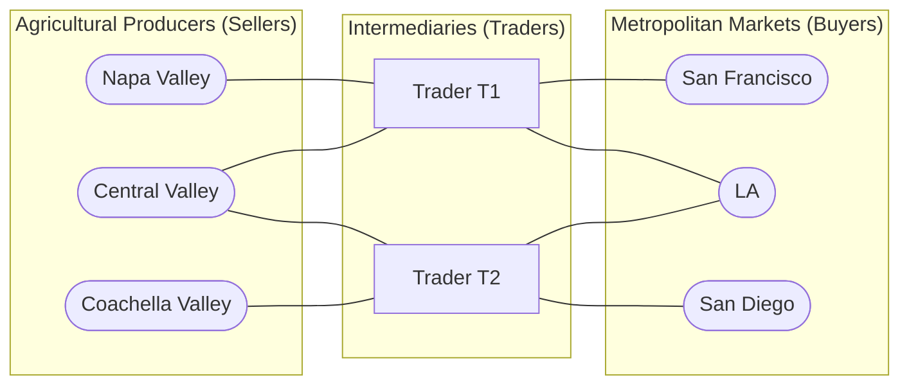
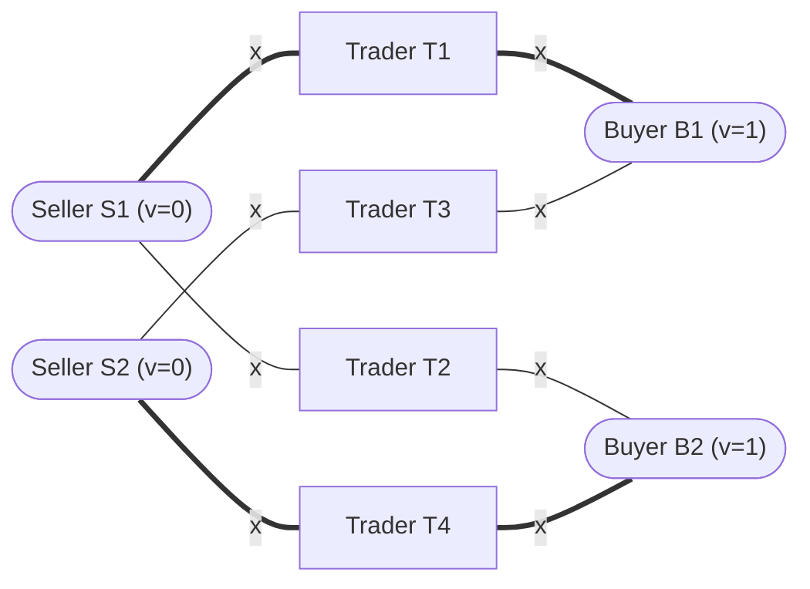

# CECS 427: Dynamic Networks — Markets with Intermediaries

---

## Slide 1: Title
* **Course:** CECS 427 Dynamic Networks
* **Topic:** Markets with Intermediaries

---

## Slide 2: Overview of Markets with Intermediaries
* In many real-world markets, buyers and sellers do not trade directly with one another; instead, they trade through **intermediaries, brokers, or middlemen** who set the prices.
* **Key Application Domains:**
  * **Agricultural Goods:** Farmers sell crops to wholesale distributors/traders, who then sell to grocery chains or urban markets.
  * **Financial & Stock Markets:**
    * **NYSE** (New York Stock Exchange)
    * **NASDAQ-OMX**
    * Market makers and limit order books intermediate between buyers and sellers of shares.

---

## Slides 3–6: The Order Book in the Stock Market
* **How a Limit Order Book Works:**
  * **Ask Orders (Sell Limit Orders):** Offers to sell a specific quantity of shares at or above a specified minimum price.
  * **Bid Orders (Buy Limit Orders):** Offers to buy a specific quantity of shares at or below a specified maximum price.
  * **Bid-Ask Spread:** The gap between the lowest Ask price (best ask) and the highest Bid price (best bid). The displayed market price is typically the midpoint of the spread.

### Visual Diagram: Evolution of the Stock Market Order Book (Slides 3–6)
```
Price Axis
    ^
    |   $5.50  ---  Ask (sell 100 shares if price >= $5.50)   [Added in Slide 4]
    |
    |   $5.00  ---  Ask (sell 100 shares if price >= $5.00)   [Best Ask - Slide 3]
    |                                                      \
    |               [Bid-Ask Spread: $4.00 to $5.00]        } --> $4.50 is displayed
    |                                                      /      (Midpoint Price - Slide 6)
    |   $4.00  ---  Bid (buy 100 shares if price <= $4.00)    [Best Bid - Slide 5]
    |
    |   $3.50  ---  Bid (buy 100 shares if price <= $3.50)    [Added in Slide 5]
    |
  Order Book
```

---

## Slide 7: Real-World Trading Network Example (California Agriculture)
* **Producers / Sellers (Left):** Agricultural valleys in California (`Napa Valley`, `Central Valley`, `Coachella Valley`).
* **Intermediaries / Traders (Middle):** Wholesale traders `T1` and `T2`.
* **Consumers / Buyers (Right):** Major metropolitan markets (`San Francisco`, `LA`, `San Diego`).



---

## Slide 8: Formal Trading Network Model Setup
* **Network Structure:**
  * **Sellers ($S_1, S_2, S_3$):** Each seller $i$ initially holds $1$ unit of an indivisible good and has a true baseline valuation $v_i = 0$ for keeping the good.
  * **Buyers ($B_1, B_2, B_3$):** Each buyer $j$ wants to buy at most $1$ unit of the good and has a true valuation $v_j = 1$ for obtaining it.
  * **Traders ($T_1, T_2$):** Connected to specific subsets of sellers and buyers via edges in the network.
    * **Connections of $T_1$:** Sellers $\{S_1, S_2\}$ and Buyers $\{B_1, B_2\}$.
    * **Connections of $T_2$:** Sellers $\{S_2, S_3\}$ and Buyers $\{B_2, B_3\}$.
    * *Notice:* $S_1$ and $B_1$ only have access to $T_1$ (captive to $T_1$). $S_3$ and $B_3$ only have access to $T_2$ (captive to $T_2$). $S_2$ and $B_2$ are connected to **both** $T_1$ and $T_2$!

---

## Slides 9–11: Bid Prices, Ask Prices, and Flow of Goods
* **Step 1 — Traders Offer Bid Prices to Sellers (Slide 9):**
  * Each trader $t$ offers a **bid price** $b_{ti}$ to each connected seller $S_i$ (the price $t$ is willing to pay $S_i$ to buy their item):
    * $T_1$ offers: $b_{11} = 0.2$ to $S_1$, and $b_{12} = 0.2$ to $S_2$.
    * $T_2$ offers: $b_{22} = 0.3$ to $S_2$, and $b_{23} = 0$ to $S_3$.
* **Step 2 — Traders Offer Ask Prices to Buyers (Slide 10):**
  * Each trader $t$ offers an **ask price** $a_{tj}$ to each connected buyer $B_j$ (the price at which $t$ is willing to sell $1$ unit to $B_j$):
    * $T_1$ offers: $a_{11} = 0.8$ to $B_1$, and $a_{12} = 0.8$ to $B_2$.
    * $T_2$ offers: $a_{22} = 0.7$ to $B_2$, and $a_{23} = 1.0$ to $B_3$.
* **Step 3 — Resulting Flow of Goods (Slide 11):**
  * Sellers sell to the connected trader offering the **highest bid price** ($\ge 0$).
  * Buyers buy from the connected trader offering the **lowest ask price** ($\le 1$).

### Diagram: Initial Prices and Flow of Goods (Slide 11)
```
v_i = 0      Sellers             Traders             Buyers      v_j = 1

  0          ( S1 ) ---- 0.2 ====> [ T1 ] === 0.8 ====> ( B1 )      1
                        /                \
                     0.2                  0.8
                      /                    \
  0          ( S2 ) --                      --> ( B2 )              1
                      \                    /
                     0.3                  0.7
                        \                /
  0          ( S3 ) ==== 0.0 ====> [ T2 ] === 1.0 ====> ( B3 )      1

Legend:
  ====> : Active trade (Red directed edges showing flow of goods)
  ----  : Inactive edge (Offer rejected in favor of a better price)
```

* **Flow Breakdown:**
  * $S_1$ sells to $T_1$ for $0.2$.
  * $S_2$ compares $0.2$ (from $T_1$) vs. $0.3$ (from $T_2$) and sells to **$T_2$** for $0.3$.
  * $S_3$ sells to $T_2$ for $0$ (indifferent between selling for $0$ and keeping at value $0$).
  * $T_1$ buys $1$ unit (from $S_1$) and sells $1$ unit to $B_1$ for $0.8$.
  * $B_2$ compares ask price $0.8$ (from $T_1$) vs. $0.7$ (from $T_2$) and buys from **$T_2$** for $0.7$.
  * $B_3$ buys from $T_2$ for $1.0$.
  * $T_2$ buys $2$ units (from $S_2, S_3$) and sells $2$ units (to $B_2, B_3$).

---

## Slide 12: Payoff Formulas in Trading Networks
* **Notation:**
  * $b_{ij}$: Bid price that trader $i$ offers to seller $j$.
  * $a_{ik}$: Ask price that trader $i$ offers to buyer $k$.
* **Payoff Definitions:**
  * **Trader $i$'s Payoff (Profit):**
    $$\text{Payoff}_{\text{Trader } i} = \sum_{\substack{\text{all buyers } k \\ \text{that accept } a_{ik}}} a_{ik} - \sum_{\substack{\text{all sellers } j \\ \text{that accept } b_{ij}}} b_{ij}$$
    *(Note: A trader cannot sell more units than they buy; usually we enforce flow conservation or heavy penalties for defaulting.)*
  * **Seller $j$'s Payoff:**
    $$\text{Payoff}_{\text{Seller } j} = b_{ij} \quad (\text{where } i \text{ is the selected trader; } 0 \text{ if no trade})$$
  * **Buyer $k$'s Payoff:**
    $$\text{Payoff}_{\text{Buyer } k} = v_k - a_{ik} = 1 - a_{ik} \quad (\text{where } i \text{ is the selected trader; } 0 \text{ if no trade})$$
* **Best Response for Sellers and Buyers:**
  * Sellers always accept the **highest bid** ($\ge v_j = 0$).
  * Buyers always accept the **lowest ask** ($\le v_k = 1$).

---

## Slide 13: Test Your Knowledge — Compute All Payoffs (Initial State)
Using the flow and prices from Slide 11/13:
* **Sellers' Payoffs:**
  * $\text{Payoff}(S_1) = b_{11} = \mathbf{0.2}$ (sells to $T_1$)
  * $\text{Payoff}(S_2) = b_{22} = \mathbf{0.3}$ (sells to $T_2$)
  * $\text{Payoff}(S_3) = b_{23} = \mathbf{0.0}$ (sells to $T_2$)
* **Buyers' Payoffs:**
  * $\text{Payoff}(B_1) = 1 - a_{11} = 1 - 0.8 = \mathbf{0.2}$ (buys from $T_1$)
  * $\text{Payoff}(B_2) = 1 - a_{22} = 1 - 0.7 = \mathbf{0.3}$ (buys from $T_2$)
  * $\text{Payoff}(B_3) = 1 - a_{23} = 1 - 1.0 = \mathbf{0.0}$ (buys from $T_2$)
* **Traders' Payoffs:**
  * $\text{Payoff}(T_1) = a_{11} - b_{11} = 0.8 - 0.2 = \mathbf{0.6}$ (trades 1 unit: $S_1 \to T_1 \to B_1$)
  * $\text{Payoff}(T_2) = (a_{22} + a_{23}) - (b_{22} + b_{23}) = (0.7 + 1.0) - (0.3 + 0.0) = 1.7 - 0.3 = \mathbf{1.4}$ (trades 2 units: $S_2, S_3 \to T_2 \to B_2, B_3$)

---

## Slides 14–15: Strategic Reaction by Trader $T_1$
* **Why is the state in Slide 13 NOT a Nash Equilibrium?**
  * Look at $T_1$:
    1. $S_1$ and $B_1$ have no other trader besides $T_1$. So $T_1$ can squeeze them completely by lowering $b_{11}$ from $0.2 \to \mathbf{0}$ and raising $a_{11}$ from $0.8 \to \mathbf{1}$!
    2. Furthermore, $T_1$ lost the trade on the middle path ($S_2 \to B_2$) to $T_2$. $T_1$ can undercut $T_2$ by offering $S_2$ a slightly higher bid ($b_{12} = \mathbf{0.4} > 0.3$) and offering $B_2$ a slightly lower ask ($a_{12} = \mathbf{0.6} < 0.7$).

### Diagram: $T_1$ Reacts and Captures the Middle Flow (Slide 15)
```
v_i = 0      Sellers             Traders             Buyers      v_j = 1

  0          ( S1 ) ==== 0.0 ====> [ T1 ] === 1.0 ====> ( B1 )      1
                        /                \
                     0.4                  0.6
                      /                    \
  0          ( S2 ) ==                      ==> ( B2 )              1
                      \                    /
                     0.3                  0.7
                        \                /
  0          ( S3 ) ==== 0.0 ====> [ T2 ] === 1.0 ====> ( B3 )      1
```

* **New Payoffs After $T_1$'s Reaction:**
  * $T_1$ now trades $2$ units:
    * Unit 1 ($S_1 \to B_1$): $1.0 - 0.0 = 1.0$.
    * Unit 2 ($S_2 \to B_2$): $0.6 - 0.4 = 0.2$.
    * Total $\text{Payoff}(T_1) = 1.0 + 0.2 = \mathbf{1.2}$ (up from $0.6$!).
  * $T_2$'s payoff drops from $1.4$ to $1.0 - 0.0 = \mathbf{1.0}$.

---

## Slide 16: Monopoly Sub-Network ($S_1 \to T_1 \to B_1$ and $S_3 \to T_2 \to B_3$)
* **Monopoly Structure:**
  * Seller $S_1$ and Buyer $B_1$ can only trade through $T_1$.
  * Because $T_1$ has a **local monopoly** on this path, in equilibrium $T_1$ sets:
    * Bid price to $S_1$: $b_{11} = 0$ (Seller gets $0$ surplus).
    * Ask price to $B_1$: $a_{11} = 1$ (Buyer gets $1 - 1 = 0$ surplus).
  * **Result:** The monopolist intermediary $T_1$ extracts $100\%$ of the social surplus ($1 - 0 = 1$) from the trade between $S_1$ and $B_1$. The exact same holds for $T_2$ with $S_3$ and $B_3$.

```
Monopoly Sub-graph:
  ( S1 ) ==== 0 ====> [ T1 ] ==== 1 ====> ( B1 )
```

---

## Slides 17–20: Perfect Competition Sub-Network ($S_2$ and $B_2$)
* Now consider the middle sub-network where both $T_1$ and $T_2$ compete for Seller $S_2$ and Buyer $B_2$:
  * **Slide 17:** $T_1$ offers $(0.4, 0.6)$ and wins the trade (profit $0.2$), while $T_2$ offers $(0.3, 0.7)$ and gets $0$ on this path.
  * **Slide 18:** $T_2$ reacts by outbidding $T_1$ (e.g., offering $0.4$ or $0.45$ to $S_2$ and $0.6$ or $0.55$ to $B_2$).
  * **Slide 19:** $T_1$ reacts again by narrowing the spread to $(0.5, 0.5)$.
  * **Slide 20 (Bertrand-Style Price Competition Equilibrium):**
    * Whenever the spread $(a - b) > 0$, the losing trader has an incentive to slightly raise the bid to $S_2$ and slightly lower the ask to $B_2$ to capture the positive profit.
    * This undercutting continues until **bid price $=$ ask price $= x$** (for example, $x = 0.5$), where **trader profit on the contested path is driven to $0$**!

### Progression of Competition for $(S_2, B_2)$ (Slides 17–20)
| Step / Slide | $T_1$ Bid to $S_2$ | $T_1$ Ask to $B_2$ | $T_2$ Bid to $S_2$ | $T_2$ Ask to $B_2$ | Active Trader & Profit on $(S_2, B_2)$ |
| :--- | :---: | :---: | :---: | :---: | :--- |
| **Slide 17** | $0.4$ | $0.6$ | $0.3$ | $0.7$ | $T_1$ wins (Profit $= 0.2$) |
| **Slide 18** | $0.4$ | $0.6$ | $0.4+\epsilon$ | $0.6-\epsilon$ | $T_2$ undercuts $T_1$ |
| **Slide 19** | $0.5$ | $0.5$ | $0.4$ | $0.6$ | $T_1$ narrows spread to $0$ |
| **Slide 20** | $0.5$ | $0.5$ | $0.5$ | $0.5$ | **Equilibrium:** Spread $= 0$, Profit $= 0$ |

---

## Slide 21: General Equilibrium Characterization of the Network
* In any Nash equilibrium of this 3-seller, 2-trader, 3-buyer network:
  * **Monopoly Edges:**
    * $S_1 \to T_1$: Bid $= 0$. $T_1 \to B_1$: Ask $= 1$.
    * $S_3 \to T_2$: Bid $= 0$. $T_2 \to B_3$: Ask $= 1$.
  * **Perfectly Competitive Middle Edges:**
    * Both $T_1$ and $T_2$ offer the exact same price $x \in [0, 1]$ as both their bid to $S_2$ and their ask to $B_2$!
    * Either $T_1$ or $T_2$ facilitates the trade from $S_2$ to $B_2$, earning $x - x = 0$ profit on that unit.
    * Seller $S_2$ gets payoff $x$, and Buyer $B_2$ gets payoff $1 - x$ (together $S_2$ and $B_2$ keep $100\%$ of the surplus $x + (1 - x) = 1$, while the traders get $0$ from them!).

```
General Equilibrium State (for any x in [0, 1]):
v_i = 0      Sellers             Traders             Buyers      v_j = 1

  0          ( S1 ) ==== 0 ====> [ T1 ] ==== 1 ====> ( B1 )        1
                        /              \
                       x                x
                      /                  \
  0          ( S2 ) ==                    ==> ( B2 )               1
                      \                  /
                       x                x
                        \              /
  0          ( S3 ) ==== 0 ====> [ T2 ] ==== 1 ====> ( B3 )        1
```

---

## Slide 22: Implicit Perfect Competition in Larger Networks
* **Network Topology:**
  * **Sellers:** $S_1, S_2$ (with $v_i = 0$).
  * **Buyers:** $B_1, B_2$ (with $v_j = 1$).
  * **Traders:** $T_1, T_2, T_3, T_4$.
  * **Edges:**
    * $T_1$ connects $S_1$ and $B_1$.
    * $T_2$ connects $S_1$ and $B_2$.
    * $T_3$ connects $S_2$ and $B_1$.
    * $T_4$ connects $S_2$ and $B_2$.



* **Key Insight (Implicit Competition):**
  * Notice that **no two traders share the exact same Seller-Buyer pair**! ($T_1, T_2, T_3, T_4$ each sit on a distinct $(S_i, B_j)$ edge pair).
  * Yet in equilibrium, **all four traders are forced to set their bids and asks to a single common value $x \in [0, 1]$**, earning **zero profit**!
  * *Why?*
    * Active trades occur on $S_1 \to T_1 \to B_1$ and $S_2 \to T_4 \to B_2$.
    * Inactive traders $T_2$ (connecting $S_1$ to $B_2$) and $T_3$ (connecting $S_2$ to $B_1$) act as **potential competitors**.
    * If $T_1$ or $T_4$ tried to charge a positive spread (say, bidding $b < a$), then $T_2$ or $T_3$ could step in, offer slightly better prices to $S_1$ and $B_2$ (or $S_2$ and $B_1$), and steal the trade for a positive profit!
    * Thus, even without direct parallel edges between the exact same buyer-seller pair, the alternating cycle $S_1 - T_1 - B_1 - T_3 - S_2 - T_4 - B_2 - T_2 - S_1$ induces **implicit perfect competition**.