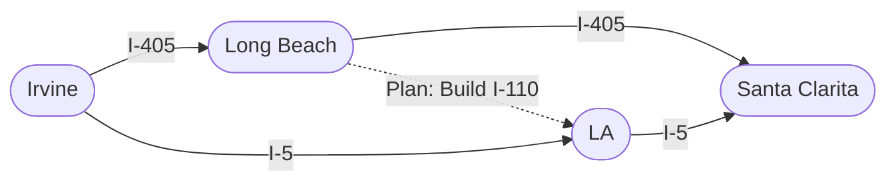

# CECS 427: Dynamic Networks — Modeling Network Traffic Using Game Theory

---

## Slide 1: Title
* **Course:** CECS 427 Dynamic Networks
* **Topic:** Modeling Network Traffic Using Game Theory

---

## Slides 2–3: Motivating Example — Freeways from Irvine to Santa Clarita
* **Initial Highway Network (Slide 2):**
  * Drivers travel from **Irvine** (origin) to **Santa Clarita** (destination).
  * **Route 1 (Northern / Coastal Route via I-405):** `Irvine` $\xrightarrow{\text{I-405}}$ `Long Beach` $\xrightarrow{\text{I-405}}$ `Santa Clarita`.
  * **Route 2 (Southern / Inland Route via I-5):** `Irvine` $\xrightarrow{\text{I-5}}$ `LA` $\xrightarrow{\text{I-5}}$ `Santa Clarita`.
* **Plan to Build Connector Highway I-110 (Slide 3):**
  * Transportation planners propose building a high-speed connector **I-110** directly from `Long Beach` $\to$ `LA`.



---

## Slides 4–7: Equilibrium Traffic Before Building I-110
* **Edge Travel Time (Latency) Functions (Slides 4–5):**
  * Suppose **$4000$ drivers** are traveling from `Irvine` to `Santa Clarita`.
  * `Irvine` $\to$ `Long Beach`: Congestible highway where travel time is **$x / 100$** minutes (where $x$ is the number of drivers using the edge).
  * `Long Beach` $\to$ `Santa Clarita`: Wide highway with constant travel time of **$45$** minutes (independent of traffic volume).
  * `Irvine` $\to$ `LA`: Wide highway with constant travel time of **$45$** minutes.
  * `LA` $\to$ `Santa Clarita`: Congestible highway where travel time is **$x / 100$** minutes.

```
              ( Long Beach )
             /              \
         x/100               45
          /                    \
( Irvine )                      v ( Santa Clarita )
          \                    /
          45               x/100
             \              /
                  ( LA )
```

* **Travel Time Analysis (Slide 6):**
  * **If all $4000$ drivers take `Irvine -> Long Beach -> Santa Clarita`:**
    $$\text{Travel Time} = \frac{4000}{100} + 45 = 40 + 45 = 85\text{ minutes}$$
  * **If all $4000$ drivers take `Irvine -> LA -> Santa Clarita`:**
    $$\text{Travel Time} = 45 + \frac{4000}{100} = 45 + 40 = 85\text{ minutes}$$
  * **If drivers divide evenly ($2000$ on each route):**
    $$\text{Travel Time on Top Route} = \frac{2000}{100} + 45 = 20 + 45 = \mathbf{65\text{ minutes}}$$
    $$\text{Travel Time on Bottom Route} = 45 + \frac{2000}{100} = 45 + 20 = \mathbf{65\text{ minutes}}$$

* **Game-Theoretic Formulation (Slide 7):**
  * **Players:** The $4000$ drivers.
  * **Strategies:** Route 1 (`Irvine-LB-SC`) or Route 2 (`Irvine-LA-SC`).
  * **Payoffs:** The **negative** of travel time (since drivers want to minimize travel time, which is equivalent to maximizing $-\text{Travel Time}$).
  * **Dominant Strategy:** None (which route is faster depends on how many other drivers choose each route).
  * **Nash Equilibrium:** Suppose $x$ drivers use `Irvine-LB-SC` and $4000 - x$ use `Irvine-LA-SC`. At equilibrium, travel times must be equal so no driver has an incentive to switch:
    $$\frac{x}{100} + 45 = 45 + \frac{4000 - x}{100} \implies x = 4000 - x \implies x^* = 2000$$
  * Thus, **$2000$ drivers on each route** is the unique Nash equilibrium, with everyone experiencing a travel time of **$65$ minutes**.

---

## Slides 8–10: Braess's Paradox — Adding a Fast Road Makes Everyone Worse Off!
* Suppose the city builds the connector **I-110** from `Long Beach` $\to$ `LA` with a travel time of **$0$ minutes** (instantaneous transit).

```
              ( Long Beach )
             /       |      \
         x/100       |       45
          /          | 0      \
( Irvine )           |         v ( Santa Clarita )
          \          v         /
          45      ( LA )   x/100
```

* **What happens now? (Slide 10):**
  * Consider the new zig-zag route: **`Irvine -> Long Beach -> LA -> Santa Clarita`**.
  * Even if all $4000$ drivers take `Irvine -> LB`, the travel time on `Irvine -> LB` is at most $\frac{4000}{100} = 40 < 45$!
  * Once at `Long Beach`, taking `LB -> LA -> SC` takes $0 + \frac{x}{100} \le 40 < 45$!
  * Therefore, taking **`Irvine -> Long Beach -> LA -> Santa Clarita` is now a strictly dominant strategy** for every single driver!
* **New Nash Equilibrium Travel Time:**
  * All $4000$ drivers take `Irvine -> Long Beach -> LA -> Santa Clarita`:
    $$\text{Travel Time} = \frac{4000}{100} + 0 + \frac{4000}{100} = 40 + 0 + 40 = \mathbf{80\text{ minutes}}$$
  * *(Checking deviations: Any driver switching to `Irvine -> LB -> SC` or `Irvine -> LA -> SC` would take $40 + 45 = 85$ minutes, so no one deviates!)*
* **Braess's Paradox:** Adding a new, zero-delay road to a network increased every driver's equilibrium commute time from **$65$ minutes to $80$ minutes**!

---

## Slides 11–14: Discrete 4-Driver Network Traffic Model
* **Network Setup (Slide 11):**
  * Nodes: $A$ (Origin), $B$, $C$, $D$ (Destination).
  * Linear edge latency functions of the form:
    $$T_e(x) = a_e x + b_e$$
  * **Specific Edge Latencies:**
    * Edge $A \to C$: $T_{AC}(x) = x$ ($a_{AC} = 1, b_{AC} = 0$)
    * Edge $C \to D$: $T_{CD}(x) = 5$ ($a_{CD} = 0, b_{CD} = 5$)
    * Edge $A \to B$: $T_{AB}(x) = 5$ ($a_{AB} = 0, b_{AB} = 5$)
    * Edge $B \to D$: $T_{BD}(x) = x$ ($a_{BD} = 1, b_{BD} = 0$)
    * Edge $C \to B$: $T_{CB}(x) = 0$ ($a_{CB} = 0, b_{CB} = 0$)
  * **Number of Drivers:** $4$ discrete drivers traveling from $A$ to $D$.

* **Definitions (Slide 12):**
  * **Traffic Pattern ($Z$):** A choice of path by each driver.
  * **Social Cost ($\text{Social-Cost}(Z)$):** The sum of the travel times experienced by all drivers in the traffic pattern.

### Comparison: Socially Optimal Pattern vs. Nash Equilibrium Pattern (Slides 13–14)

| Feature | Socially Optimal Pattern (Slide 13) | Nash Equilibrium Pattern (Slide 14) |
| :--- | :--- | :--- |
| **Path Assignments** | • $2$ drivers take $A \to C \to D$<br>• $2$ drivers take $A \to B \to D$ | • All $4$ drivers take $A \to C \to B \to D$ |
| **Edge Loads ($x_e$)** | $x_{AC}=2, x_{CD}=2, x_{AB}=2, x_{BD}=2, x_{CB}=0$ | $x_{AC}=4, x_{CB}=4, x_{BD}=4, x_{CD}=0, x_{AB}=0$ |
| **Individual Travel Time** | $2 + 5 = \mathbf{7}$ per driver | $4 + 0 + 4 = \mathbf{8}$ per driver |
| **Total Social Cost** | $4 \times (2 + 5) = \mathbf{28}$ | $4 \times (4 + 0 + 4) = \mathbf{32}$ |
| **Equilibrium Check** | **Not an Equilibrium:** A driver on $A \to C \to D$ (time $7$) can switch to $A \to C \to B \to D$ and get time $2 + 0 + 3 = \mathbf{5} < 7$! | **Nash Equilibrium:** Switching to $A \to C \to D$ gives $4 + 5 = 9 > 8$; switching to $A \to B \to D$ gives $5 + 4 = 9 > 8$. |

---

## Slide 15: Analyzing Best-Response Dynamics via Potential Energy (Rosenthal's Potential)
* **How do we track best-response dynamics and prove it converges to a Nash equilibrium?**
* **Definition — Edge Potential Energy:**
  * For a single edge $e$ with $x$ drivers on it, its **potential energy** is defined as the **cumulative sum** of latencies from $1$ up to $x$:
    $$\text{Energy}_e(x) = T_e(1) + T_e(2) + \dots + T_e(x) = \sum_{k=1}^{x} T_e(k)$$
  * *(By convention, $\text{Energy}_e(0) = 0$.)*
* **Total Network Potential Energy:**
  * For a traffic pattern $Z$, the total potential energy $\text{Energy}(Z)$ is the sum of $\text{Energy}_e(x_e)$ over all edges $e$ in the network.
  * *Important Distinction:* $\text{Energy}_e(x) = \sum_{k=1}^x T_e(k)$ is a cumulative sum, unlike the total travel time on edge $e$, which is $x \cdot T_e(x)$.

---

## Slides 16–20: Step-by-Step Best-Response Dynamics & Potential Energy Trace
Starting from the Socially Optimal state (2 drivers on $A \to C \to D$, 2 drivers on $A \to B \to D$), let drivers switch paths one by one whenever they can strictly reduce their own travel time:

| Step (Slide) | Paths Taken by the 4 Drivers | Edge Loads $(x_{AC}, x_{AB}, x_{CD}, x_{BD}, x_{CB})$ | Edge Energies $\text{Energy}_e(x_e)$ | Total Potential Energy |
| :--- | :--- | :---: | :--- | :---: |
| **State 0** (Slide 16) | • 2 on $A \to C \to D$<br>• 2 on $A \to B \to D$ | $(2, 2, 2, 2, 0)$ | • $\text{Energy}_{AC}(2) = 1 + 2 = 3$<br>• $\text{Energy}_{AB}(2) = 5 + 5 = 10$<br>• $\text{Energy}_{CD}(2) = 5 + 5 = 10$<br>• $\text{Energy}_{BD}(2) = 1 + 2 = 3$ | $3 + 10 + 10 + 3 = \mathbf{26}$ |
| **Step 1** (Slide 17)<br>*(1 driver switches $A\text{-}C\text{-}D \to A\text{-}C\text{-}B\text{-}D$, time drops $7 \to 5$)* | • 1 on $A \to C \to D$<br>• 1 on $A \to C \to B \to D$<br>• 2 on $A \to B \to D$ | $(2, 2, 1, 3, 1)$ | • $\text{Energy}_{AC}(2) = 1 + 2 = 3$<br>• $\text{Energy}_{AB}(2) = 5 + 5 = 10$<br>• $\text{Energy}_{CD}(1) = 5$<br>• $\text{Energy}_{BD}(3) = 1 + 2 + 3 = 6$ | $3 + 10 + 5 + 6 = \mathbf{24}$<br>*(Drops by $7 - 5 = 2$)* |
| **Step 2** (Slide 18)<br>*(2nd driver switches $A\text{-}C\text{-}D \to A\text{-}C\text{-}B\text{-}D$, time drops $7 \to 6$)* | • 2 on $A \to C \to B \to D$<br>• 2 on $A \to B \to D$ | $(2, 2, 0, 4, 2)$ | • $\text{Energy}_{AC}(2) = 1 + 2 = 3$<br>• $\text{Energy}_{AB}(2) = 5 + 5 = 10$<br>• $\text{Energy}_{CD}(0) = 0$<br>• $\text{Energy}_{BD}(4) = 1 + 2 + 3 + 4 = 10$ | $3 + 10 + 0 + 10 = \mathbf{23}$<br>*(Drops by $7 - 6 = 1$)* |
| **Step 3** (Slide 19)<br>*(3rd driver switches $A\text{-}B\text{-}D \to A\text{-}C\text{-}B\text{-}D$, time drops $9 \to 7$)* | • 3 on $A \to C \to B \to D$<br>• 1 on $A \to B \to D$ | $(3, 1, 0, 4, 3)$ | • $\text{Energy}_{AC}(3) = 1 + 2 + 3 = 6$<br>• $\text{Energy}_{AB}(1) = 5$<br>• $\text{Energy}_{CD}(0) = 0$<br>• $\text{Energy}_{BD}(4) = 1 + 2 + 3 + 4 = 10$ | $6 + 5 + 0 + 10 = \mathbf{21}$<br>*(Drops by $9 - 7 = 2$)* |
| **Step 4** (Slide 20)<br>*(4th driver switches $A\text{-}B\text{-}D \to A\text{-}C\text{-}B\text{-}D$, time drops $9 \to 8$)* | • 4 on $A \to C \to B \to D$<br>**(Nash Equilibrium)** | $(4, 0, 0, 4, 4)$ | • $\text{Energy}_{AC}(4) = 1 + 2 + 3 + 4 = 10$<br>• $\text{Energy}_{AB}(0) = 0$<br>• $\text{Energy}_{CD}(0) = 0$<br>• $\text{Energy}_{BD}(4) = 1 + 2 + 3 + 4 = 10$ | $10 + 0 + 0 + 10 = \mathbf{20}$<br>*(Drops by $9 - 8 = 1$)* |

---

## Slide 21: Test Your Knowledge — Find the Minimal Potential Energy
* **Network Setup (Slide 21):**
  * 4 drivers traveling from $A$ to $D$.
  * Edge latencies:
    * $T_{AC}(x) = 2x + 1$
    * $T_{CD}(x) = 10$
    * $T_{AB}(x) = 10$
    * $T_{BD}(x) = 2x + 1$
    * $T_{CB}(x) = 0$

* **Step 1: Initial State Shown on Slide (2 drivers on $A \to C \to D$, 2 drivers on $A \to B \to D$):**
  * $\text{Energy}_{AC}(2) = T_{AC}(1) + T_{AC}(2) = 3 + 5 = 8$
  * $\text{Energy}_{AB}(2) = 10 + 10 = 20$
  * $\text{Energy}_{CD}(2) = 10 + 10 = 20$
  * $\text{Energy}_{BD}(2) = T_{BD}(1) + T_{BD}(2) = 3 + 5 = 8$
  * Initial Potential Energy $= 8 + 20 + 20 + 8 = \mathbf{56}$.

* **Step 2: Finding the Minimal Potential Energy (Nash Equilibrium):**
  * Since for $x \le 4$, $T_{AC}(x) = 2x + 1 \le 9 < 10$ and $T_{BD}(x) = 2x + 1 \le 9 < 10$, every driver strictly prefers taking the zig-zag path $A \to C \to B \to D$!
  * At the unique Nash equilibrium (minimal potential energy state), **all 4 drivers take $A \to C \to B \to D$** ($x_{AC} = 4, x_{AB} = 0, x_{CD} = 0, x_{BD} = 4, x_{CB} = 4$):
    * $\text{Energy}_{AC}(4) = T_{AC}(1) + T_{AC}(2) + T_{AC}(3) + T_{AC}(4) = 3 + 5 + 7 + 9 = \mathbf{24}$
    * $\text{Energy}_{AB}(0) = \mathbf{0}$
    * $\text{Energy}_{CD}(0) = \mathbf{0}$
    * $\text{Energy}_{BD}(4) = T_{BD}(1) + T_{BD}(2) + T_{BD}(3) + T_{BD}(4) = 3 + 5 + 7 + 9 = \mathbf{24}$
    * $\text{Energy}_{CB}(4) = 0 + 0 + 0 + 0 = \mathbf{0}$
  * **Minimal Potential Energy:** $24 + 0 + 0 + 24 = \mathbf{48}$.

---

## Slide 22: Why Potential Energy Works (Exact Tracking of Individual Deviations)
* Recall: $\text{Energy}_e(x) = T_e(1) + T_e(2) + \dots + T_e(x - 1) + T_e(x)$.
* **When a driver abandons link $e$ (load drops from $x$ to $x - 1$):**
  * The decrease in potential energy on link $e$ is:
    $$\text{Energy}_e(x) - \text{Energy}_e(x - 1) = T_e(x)$$
  * This is **isahkan/exactly the travel time that the driver was experiencing on link $e$ before leaving**!
* **When a driver joins link $e$ (load increases from $x$ to $x + 1$):**
  * The increase in potential energy on link $e$ is:
    $$\text{Energy}_e(x + 1) - \text{Energy}_e(x) = T_e(x + 1)$$
  * This is **exactly the new travel time that the driver experiences on link $e$ after joining**!
* **Fundamental Consequence:**
  * When a single driver switches from path $P$ to path $P'$, the net change in the total network potential energy $\Delta \text{Energy}(Z)$ is **strictly equal to the change in that single driver's personal travel time**!
  * Therefore, every best-response move that reduces a driver's travel time strictly decreases $\text{Energy}(Z)$, guaranteeing that best-response dynamics cannot cycle and must terminate at a **Nash equilibrium** (local minimum of $\text{Energy}(Z)$).

---

## Slides 23–25: Relating Potential Energy to Social Cost (Price of Anarchy Bound)
* **For a Single Edge $e$ with Linear Latency $T_e(x) = a_e x + b_e$ (Slide 23):**
  * **Potential Energy:**
    $$\text{Energy}_e(x) = T_e(1) + T_e(2) + \dots + T_e(x)$$
  * **Total Travel Time (Social Cost on Edge $e$):**
    $$\text{TravelTime}_e(x) = x \cdot T_e(x) = \underbrace{T_e(x) + T_e(x) + \dots + T_e(x)}_{x \text{ terms}}$$
  * **Claim:**
    $$\frac{1}{2} \text{TravelTime}_e(x) \le \text{Energy}_e(x) \le \text{TravelTime}_e(x)$$
  * **Algebraic Proof:**
    * Since $T_e(k) \le T_e(x)$ for all $k \le x$, clearly $\text{Energy}_e(x) \le x T_e(x) = \text{TravelTime}_e(x)$.
    * For the lower bound:
      $$\text{Energy}_e(x) = \sum_{k=1}^x (a_e k + b_e) = a_e (1 + 2 + \dots + x) + b_e x = a_e \frac{x(x + 1)}{2} + b_e x$$
      *(Note: Even using $\frac{x(x-1)}{2}$ or $\frac{x(x+1)}{2}$, since $\frac{x+1}{2} \ge \frac{x}{2}$ and $b_e x \ge \frac{1}{2} b_e x$):*
      $$\text{Energy}_e(x) = x \left( a_e \frac{x + 1}{2} + b_e \right) \ge \frac{1}{2} x (a_e x + b_e) = \frac{1}{2} \text{TravelTime}_e(x)$$

### Geometric Proof Diagram (Slide 24)
```
Latency T_e(x)
  ^
  |                                           +-------+
  |                                           |       |
  |                                   +-------+       |
  |                                   |       |       |
  |                           +-------+       |       |
  |                           |       |       |       |
  |                   +-------+       |       |       |
  |                   |       |  ...  |T(x-1) | T_e(x)|
  |           +-------+ T_e(3)|       |       |       |
  |           | T_e(2)|       |       |       |       |
  |   +-------+       |       |       |       |       |
  |   | T_e(1)|       |       |       |       |       |
  +---+-------+-------+-------+-------+-------+-------+---> Traffic x
  0   1       2       3      ...     x-1      x
```
* **Geometric Interpretation:**
  * The outer bounding rectangle has width $x$ and height $T_e(x)$, so its area is $\text{TravelTime}_e(x) = x \cdot T_e(x)$.
  * The step-function bars have total area $\text{Energy}_e(x) = \sum_{k=1}^x T_e(k)$, which clearly encloses the lower triangle (at least half the rectangle's area) and is contained within the full rectangle!

* **Global Social Cost Bound & Price of Anarchy (Slide 25):**
  * Summing the single-edge inequality over all edges $e$ in any traffic pattern $Z$:
    $$\frac{1}{2} \text{Social-Cost}(Z) \le \text{Energy}(Z) \le \text{Social-Cost}(Z)$$
  * **Price of Anarchy Consequence:** If $Z^*$ is the Socially Optimal traffic pattern and $Z_{\text{NE}}$ is a Nash Equilibrium obtained by minimizing Potential Energy ($\text{Energy}(Z_{\text{NE}}) \le \text{Energy}(Z^*)$), then:
    $$\frac{1}{2} \text{Social-Cost}(Z_{\text{NE}}) \le \text{Energy}(Z_{\text{NE}}) \le \text{Energy}(Z^*) \le \text{Social-Cost}(Z^*)$$
    $$\implies \text{Social-Cost}(Z_{\text{NE}}) \le 2 \cdot \text{Social-Cost}(Z^*)$$
  * That is, the Social Cost of a Nash Equilibrium in a linear-latency network is at most $2$ times the optimal Social Cost!